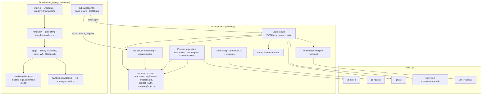
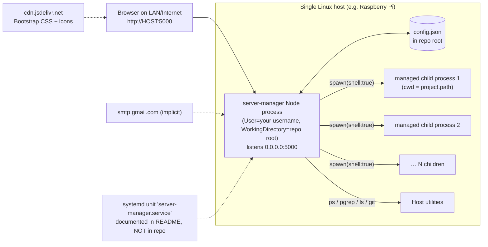
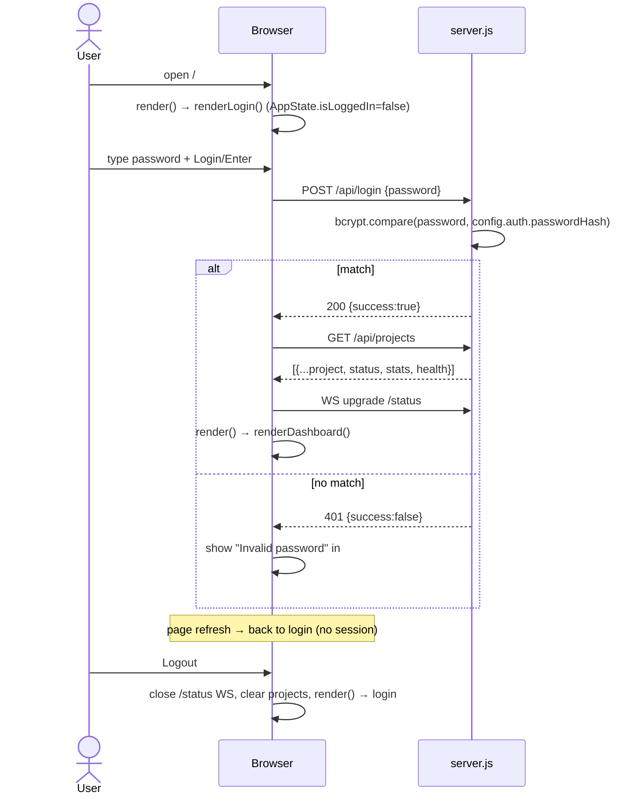
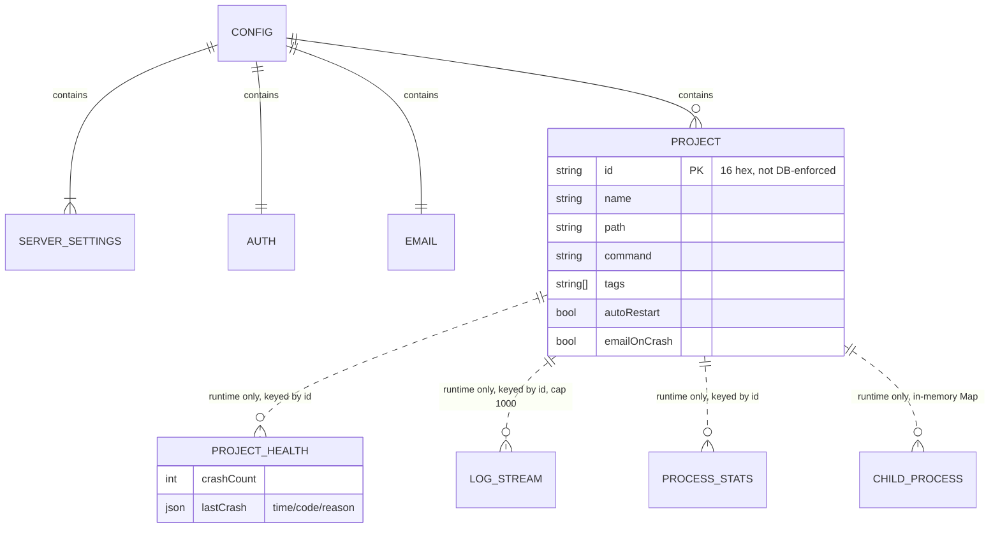

# Server Manager — System Specification (Current State)

**Document type:** Reverse-engineered technical and functional specification
**Subject application:** `server-manager` (package name `server-manager`, v1.0.0)
**Repository root:** project root containing `server.js`, `setup.js`, `public/`, `package.json`
**Investigation date:** 2026-10-09
**Purpose:** Standalone, rebuild-ready reference describing *what the application currently is and does*, including defects and inconsistencies. This document does **not** propose improvements; improvement planning is a separate phase.

---

## 1. Executive Summary

`server-manager` is a small, single-process Node.js web application for administering a personal Linux host (documented target: Raspberry Pi / Ubuntu / Debian). It provides a browser UI for:

- Managing a list of user-defined **projects** (arbitrary shell commands run in a chosen working directory) with start / stop / restart / `git pull` operations.
- Streaming and inspecting **per-project stdout/stderr logs** over WebSockets.
- Displaying **per-process CPU / memory / uptime metrics** sampled once per second with `ps`.
- Tracking **crashes** (non-zero exit codes), surfacing them on project cards, and optionally e-mailing an alert.
- A full **file manager** page (browse, view, edit, save, upload) and two **command-execution** surfaces (a "Run Command" modal and a file-manager terminal).
- A **CLI setup wizard** (`npm run setup`) that writes `config.json` (port, host, bcrypt password hash, optional Gmail credentials, project list).

Architecturally it is a **monolithic Express app with no framework on the client**: one server file (`server.js`, 986 lines) owns HTTP, WebSocket, process supervision, metrics and e-mail; the browser app is plain ES5/ES2015 JavaScript rendered by string-template functions into `#app`, styled with Bootstrap 5 loaded from a CDN. Persistence is a single JSON file (`config.json`); there is **no database, no session store, no router, no build step, no tests, and no CI**.

The most consequential characteristics a replacement must understand:

1. **There is no server-side authentication or authorization.** `POST /api/login` performs a bcrypt comparison, but success only sets a boolean in browser memory. Every other HTTP endpoint and both WebSocket upgrades are completely unauthenticated and unthrottled. The "login" is a cosmetic UI gate.
2. **The application is an unrestricted remote shell + arbitrary file read/write for anyone who can reach the port** (`POST /api/execute`, `POST /api/file/read`, `POST /api/file/write`), with the only "protection" being a substring check for `..` on three file endpoints.
3. **"Projects" are not OS services.** They are child processes spawned via `child_process.spawn(cmd, {shell: true})` held in an in-memory `Map`. Nothing survives a restart of the manager except the project *definitions* in `config.json` (and, accidentally, some runtime state — see ISSUE-006).
4. **"Auto-restart" means "start when the manager starts", not "restart on crash".** Crashed projects stay down.
5. The server **does not bind its port until after a network readiness check and stabilization delay** (up to ~35 s offline), which affects any supervisor/health-check topology (§7, §8).

Evidence standards and confidence labels used throughout: **Verified** (traced in source / executed safely in isolation), **Strongly inferred**, **Unverified**, **Missing/Incomplete**, **Conflicting**, **Unknown**. See §2.

---

## 2. Scope, Investigation Methodology, and Evidence Standards

### 2.1 Scope

In scope: everything in the repository root except `your-task.md` (the investigation prompt itself, not application code). The repository contains **18 application files** (§4).

Out of scope / excluded:

- Runtime observation of a live server: **not performed** (§2.4).
- Exploitation or penetration testing: **not performed** (§19 is a static security review only).
- The three managed projects referenced by `config.json` (`/home/<user>/Documents/...`): **not inspected**; they are separate applications outside this repository.

### 2.2 Method

1. Full file listing of the repository (no hidden files, no `.git`, no `node_modules` present).
2. Read every first-party file end-to-end: `server.js` (986 lines), `setup.js` (276), `public/index.html` (31), `public/styles.css` (312), and all 9 frontend JS files (2 336 lines total).
3. Static cross-reference greps: every `app.<method>` route, every `fetch(`/`new WebSocket` call site, every function definition vs. every call site (to find dead and undefined functions), every `localStorage` key, every `TODO/FIXME/HACK/XXX`.
4. Dependency inventory from `package.json` + `package-lock.json` (lockfileVersion 3, 165 locked packages) with declared-vs-resolved comparison.
5. Isolated, side-effect-free execution of two pure functions extracted from source (`formatUptime`, `parseFileList`) and two micro-proofs (path normalization, JS block scoping) — see §23.
6. Syntax validation of all 11 JS files with `node --check` (§23).

### 2.3 Evidence labels

| Label | Meaning |
|---|---|
| **Verified** | Established directly by source code, configuration, or a safe, side-effect-free execution described in §23. |
| **Strongly inferred** | Supported by several converging code paths but not executed end-to-end. |
| **Unverified** | Plausible from code but not confirmed (usually requires a running host). |
| **Missing/Incomplete** | An expected or referenced implementation is absent, disconnected, or non-functional. |
| **Conflicting** | Two parts of the project disagree (e.g., README vs. code). |
| **Unknown** | Insufficient evidence. |

### 2.4 Investigation limitations (must be carried forward)

| # | Limitation | Consequence |
|---|---|---|
| L-1 | `node` is not installed in the investigation environment (only a Windows `node.exe` v24.20.0 reachable through WSL interop); `node_modules` is absent; dependency installation was prohibited by the investigation rules. | The server was **never started**. No HTTP request, WebSocket frame, process spawn, `ps` sample, e-mail, or upload was executed against the live application. |
| L-2 | Starting the application would have spawned three real managed processes (`autoRestart: true` on three projects in `config.json`) and bound `0.0.0.0:5000`. | Auto-start, port binding, real `ps` sampling, git-pull, and e-mail paths are **statically analysed only** (labelled Strongly inferred / Unverified where relevant). |
| L-3 | No `.git` directory and no Git history. | No commit history, abandoned-feature archaeology, or `.gitignore` verification possible. |
| L-4 | Managed project source trees and the production host were not inspected. | OS-level assumptions (systemd unit, `ps`/`pgrep` availability, HOME value, permissions) are documented from README/code only. |
| L-5 | No tests exist to run (§23). | Every "verification" is static analysis plus isolated pure-function execution. |

No application file was modified during this investigation. The only files created are this specification and, if needed, supplementary documents under `system-specification/`.

---

## 3. Current Project State

| Aspect | State |
|---|---|
| Version | `1.0.0` (`package.json:3`) |
| Repository | `git+https://github.com/DillonFayas/server-manager.git` (declared in `package.json`; **no local Git metadata present** — Unknown whether the working tree is clean or matches any remote) |
| License | `ISC` (declared; no `LICENSE` file present) |
| Origin | `README.md:1` states: "This whole project was vibe-coded by Claude" |
| File dates | `config.json`, `package.json`, `setup.js`, `public/index.html`, `public/styles.css` → 2026-01-16; `server.js`, `package-lock.json` → 2026-09-19; `README.md` → 2026-09-19; task prompt → 2026-10-09. **Strongly inferred:** backend and lockfile were reworked ~8 months after the initial scaffold; the frontend core files were not touched since January. |
| Dependencies installed | **No** (`node_modules/` absent) |
| Tests | **None** |
| Lint / typecheck / formatter config | **None** |
| CI/CD, containers, IaC | **None** |
| `.gitignore` | **Missing** — yet `README.md:318` claims config.json is "automatically excluded from git via `.gitignore`" (**Conflicting** → ISSUE-007) |
| Runtime configuration present | Yes — `config.json` exists and is populated (6 projects, bcrypt hash present, e-mail enabled) |
| Known self-documented debt | `README.md:8-9` "Future Changes: Do not hard code 'dilly' as the home directory…" |

### 3.1 Readiness verdict for a rebuild

The application is **functionally complete for its advertised feature set except where explicitly marked Missing/Incomplete in §24/§28**, but it is **not production-safe**: it has no real authentication, no authorization, no rate limiting, no tests, and several dead/broken UI affordances. A replacement must decide deliberately which of these behaviours are *contracts to preserve* (routes, payloads, UX flow) and which are *defects to fix* (§24, §27).

---

## 4. Repository Structure and File Inventory

### 4.1 Directory tree (meaningful content only)

```
server-manager/
├── README.md                    389 L   User/ops documentation (partly contradicts code)
├── your-task.md                1022 L   Investigation prompt — NOT application code
├── package.json                  32 L   Manifest: 5 deps, 1 devDep, 3 scripts
├── package-lock.json            lockfileVersion 3, 165 locked packages
├── config.example.json           17 L   Template configuration (committed shape)
├── config.json                        Runtime configuration + secrets + project list (populated)
├── server.js                    986 L   Entire backend: HTTP, WS, process mgmt, metrics, e-mail
├── setup.js                     276 L   Interactive CLI first-run/re-run configuration wizard
└── public/
    ├── index.html                31 L   Single HTML shell; loads Bootstrap 5.3.0 + icons from jsDelivr CDN
    ├── styles.css               312 L   Custom theme, animations, log, context-menu, grid styles
    └── js/
        ├── main.js              295 L   Global AppState, theme/prefs, tag filters, render() dispatcher
        ├── api.js               484 L   All fetch() calls, status-WebSocket, DOM patching helpers
        ├── handlemodals.js      621 L   Modal open/close, logs modal logic, command modal, context menu
        ├── handlefilemanager.js 661 L   File manager state, navigation, editor, upload, FM terminal
        └── renders/
            ├── login.js          27 L   Login card markup
            ├── projectCard.js   169 L   Per-project card markup
            ├── modals.js        281 L   Markup for 6 modals
            ├── dashboard.js     130 L   Navbar + project grid + tag filter + modal mounting
            └── filemanager.js   268 L   File Manager 3-column markup + file-type icon map
```

**Total first-party code:** ~4 600 lines across 12 source files.

### 4.2 Explicitly absent artifacts (Verified by exhaustive `find`)

`.git`, `.gitignore`, `.env*`, `node_modules/`, any `*test*`/`*spec*` file, `jest.config.*`, `.eslintrc*`, `.prettierrc*`, `tsconfig.json`, `Dockerfile`, `docker-compose.yml`, `.github/`, `Makefile`, `LICENSE`, `CHANGELOG`, systemd unit file, log directory, database files/migrations.

### 4.3 Generated / vendored / third-party content

| Item | Treatment |
|---|---|
| `package-lock.json` | Generated; authoritative for resolved versions (§5). |
| `public/index.html` CDN links | Third-party at runtime (`cdn.jsdelivr.net` Bootstrap 5.3.0 CSS, bootstrap-icons 1.11.1 CSS). Not vendored, no Subresource Integrity hashes (**Verified**, `public/index.html:7-8`). |
| `config.json` | Runtime-generated by `setup.js`; contains secrets. Must never be reproduced in documentation. |
| `/tmp/` multer destination | Runtime temp storage outside the repo (`server.js:704`). |

---

## 5. Technology Stack and Dependency Inventory

### 5.1 Runtime and language

| Technology | Version evidence | Where used |
|---|---|---|
| JavaScript (backend) | CommonJS, Node.js. `README.md:60` declares "Node.js 14 or higher"; code uses optional chaining (`proc.stdout?.on`, `server.js:286`) requiring **Node ≥ 14**. Syntax-checked successfully with **Node v24.20.0** (§23). | `server.js`, `setup.js` |
| JavaScript (frontend) | ES2017+ (async/await, template literals, spread, optional chaining in `main.js:236`). No transpiler, no bundler, no modules — all files are classic `<script>` tags sharing one global scope. | `public/js/**` |
| Markup/CSS | HTML5, Bootstrap 5.3.0 (CDN) + custom CSS | `public/` |

There is **no TypeScript, no JSX, no CSS preprocessor, no bundler** (no `webpack`/`vite`/`rollup`/`esbuild` configuration anywhere).

### 5.2 Declared vs. resolved dependencies

| Package | Declared (`package.json`) | Locked (`package-lock.json`) | Actually used? | Purpose / call sites |
|---|---|---|---|---|
| `express` | `^4.18.2` | **4.22.1** | Yes | HTTP server, JSON body parsing, static file serving (`server.js:1,12,58,59`) |
| `ws` | `^8.14.2` | **8.18.3** | Yes | WebSocket server for log streaming + status broadcasts (`server.js:7,14,408-453`) |
| `bcrypt` | `^5.1.1` | **5.1.1** (native addon) | Yes | Hash in `setup.js:199`, compare in `server.js:461` |
| `nodemailer` | `^6.9.7` | **6.10.1** | Yes, only if `email.enabled` | Crash e-mail transport (`server.js:32-38,68`) |
| `multer` | `^2.0.2` | **2.0.2** | Yes | Single-file upload to `/tmp/` (`server.js:704,706`) |
| `nodemon` (dev) | `^3.0.1` | **3.1.11** | Only via `npm run dev` | Auto-restart during development (`package.json:8`) |

**Declared-but-unused:** none.
**Used-but-undeclared (Node built-ins):** `child_process` (`spawn`, `exec`), `fs/promises`, `path`, `crypto`, `http`, `dns` (lazy-required at `server.js:921`), `readline` (setup only).

**Total locked dependency tree:** 165 packages (express + multer + ws + bcrypt + nodemailer + nodemon transitive closure). Express's own tree includes `body-parser` 1.20.4 and `send` 0.19.2 (both indirectly relevant to body size limits and `res.download`).

### 5.3 Frontend libraries

| Library | Version | Load method | Used for |
|---|---|---|---|
| Bootstrap CSS | 5.3.0 | jsDelivr CDN `<link>` | Layout, grid, navbar, modals, badges, forms, alerts (`public/index.html:7`) |
| Bootstrap Icons | 1.11.1 | jsDelivr CDN `<link>` | All iconography (`public/index.html:8`) |
| Bootstrap JS | **not loaded** | — | Modals are hand-rolled via `.modal` class toggling in `styles.css:34-47`; no jQuery, no Bootstrap bundle |

**Implication for rebuild:** modal behaviour, backdrop, focus trapping and Escape handling are entirely custom (and largely absent — see ISSUE-019).

### 5.4 System/external dependencies (host executables)

| Executable / capability | Required by | Consequence if absent |
|---|---|---|
| POSIX shell (`/bin/sh`, via `spawn(..., {shell:true})`) | Project start (`server.js:266`), command execution (`server.js:869`) | Projects/commands cannot run |
| `ps` | CPU/memory sampling (`server.js:148`) | Stats resolve to `{cpu:0,memory:0}` (error path, `server.js:151-154`). Documented in `README.md:62` |
| `pgrep` | Child-PID discovery (`server.js:128`) | **Not documented in README.** Errors are swallowed → `getChildPids` returns `[]` (`server.js:129-132`), so child aggregation and process-tree kill degrade to the single root PID |
| `ls` (`-F`, `-lAF`) | All directory listings (`handlemodals.js:370`, `handlefilemanager.js:71`) | **Not documented.** Both file browsers show "Directory not accessible or empty" / "Failed to load directory" |
| `git` | `Update` button and git-prefixed commands (`server.js:745-771`, `836-855`) | Update returns failure payload; documented optional (`README.md:63`) |
| DNS resolution of `google.com` | Startup readiness gate (`server.js:922`) | Startup delayed up to 30 s (then proceeds) |
| Outbound SMTP (Gmail) | Crash e-mails when enabled | Failure logged to console only (`server.js:81`) |
| `bash`-family history / TTY | — | Not used; command history is an in-memory JS array |

Verified present in the investigation environment: `ps`, `pgrep`, `git`. Not verified: production host.

### 5.5 Styling and theme implementation

- Theme mechanism: `data-bs-theme` attribute on `<body>` (`public/index.html:11`, set by `initTheme()` `main.js:41`), i.e. Bootstrap 5's native dark/light theming, default **dark**.
- Custom palette/effects in `public/styles.css`: log container (`#1e1e1e`), log color classes `.log-error/.log-warn/.log-info/.log-success` (lines 97-112), status pulse/spin keyframes (54-84), resource bars (120-145), context menu (154-191), responsive project grid breakpoints (206-232: ≥1400 px → 4-up, 992-1399 → 3-up, 768-991 → 2-up, <768 → 1-up), upload zone (281-300).
- No CSS variables of its own beyond Bootstrap's (`--bs-*`).

---

## 6. Architecture and Component Responsibilities

### 6.1 Component map



### 6.2 Responsibilities

| Component | File | Responsibility | Notably *not* its responsibility |
|---|---|---|---|
| HTTP layer | `server.js:458-863` | 16 JSON endpoints + static hosting | Authentication, authorization, validation, rate limiting |
| WebSocket layer | `server.js:408-453` | Route upgrades to `/logs/:id` and `/status`; replay log buffer on connect | Authentication; message handling (incoming messages ignored, `server.js:444`) |
| Process supervisor | `server.js:256-396` | spawn/kill child process trees, capture logs, track exit, count crashes | Restart-on-crash supervision, persistence of runtime state, PID files |
| Metrics sampler | `server.js:140-195` | 1 Hz `pgrep`+`ps` aggregation, broadcast | Historical metrics, thresholds, disk/network metrics |
| Config store | `server.js:23-95` | Read whole JSON at boot; write whole JSON on mutation | Atomic writes, schema validation, migrations, file locking |
| E-mail notifier | `server.js:62-83, 32-43` | Send one HTML-free text mail + log attachment on crash | Retry, queue, de-duplication |
| Setup wizard | `setup.js` | Interactive stdin prompts → `config.json` | Editing individual projects; password reset without full re-run |
| Frontend state | `public/js/main.js:7-35` | One mutable global `AppState` object | Any server-state cache invalidation other than full `fetchProjects()` |
| Frontend render | `public/js/main.js:240-250` | Choose one of 3 top-level views and replace `#app.innerHTML` | Partial rendering (except two deliberate exceptions, §9.4) |

### 6.3 Frontend rendering model (critical for rebuild)

`render()` (`main.js:240-250`) does a **full innerHTML replacement** of `#app`:

```
!isLoggedIn              → renderLogin()
currentView==='filemanager' → renderFileManager()
else                      → renderDashboard()   (which embeds all 6 modal templates)
```

Consequences (**Verified** by reading the templates):
- Every `fetchProjects()` call triggers `render()`, which **destroys and rebuilds all mounted modals** in their default hidden state (`dashboard.js:121-126`). Any DOM state inside a modal that is not re-derived (filter text, scroll position) is lost.
- Status/metric updates deliberately **bypass** `render()` and patch individual elements by id (`api.js:81-144`) so animations and open modals survive. This dual path (full re-render vs. surgical patch) is a defining behaviour of the current app.
- There is **no URL/hash routing**; view state lives only in `AppState.currentView`.

---

## 7. Application Startup and Runtime Lifecycle

### 7.1 Entry points

| Entry point | Command | File |
|---|---|---|
| Production server | `npm start` → `node server.js` | `package.json:7` |
| Development server | `npm run dev` → `nodemon server.js` | `package.json:8` |
| Setup wizard | `npm run setup` → `node setup.js` | `package.json:9` |

### 7.2 Startup sequence (Verified — `server.js:972-986`)

```mermaid
sequenceDiagram
    participant OS as OS / npm
    participant S as server.js module
    participant C as config.json
    participant N as Network/DNS
    participant P as Managed projects
    participant L as server.listen

    OS->>S: node server.js
    S->>S: require deps; create express app, http server, ws server (noServer)
    S->>S: setInterval(updateAllStats, 1000)  ← runs immediately, even before listen
    S->>C: read config.json (utf8) + JSON.parse
    alt parse/read fails
        S->>OS: console.error + process.exit(1)
    end
    S->>S: if email.enabled → nodemailer.createTransport(...)
    S->>S: PORT = config.server.port||5000, HOST = config.server.host||'0.0.0.0'
    S->>N: autoStartProjects() → waitForSystemReady()
    loop up to 30 attempts, 1 s apart
        N-->>S: dns.resolve('google.com')
        alt success
            S->>S: break out of wait loop
        end
    end
    S->>S: await fixed 5 s "services stabilize" delay
    loop each project with autoRestart:true (2 s apart)
        S->>P: startProject(project) → spawn(command, {shell:true, cwd})
        P-->>S: pid, stdout/stderr streams
    end
    S->>L: server.listen(PORT, HOST)
    L-->>OS: "Server Manager running on http://HOST:PORT"
```

Text equivalent (`server.js:972-986`):

1. `loadConfiguration()` — read `config.json` (path is `__dirname`-relative, `server.js:17`); on any failure print *"Please run `npm run setup`…"* and `process.exit(1)`.
2. Read `config.server.port` (default 5000) and `config.server.host` (default `0.0.0.0`).
3. `await autoStartProjects()` — **the HTTP server is not listening yet**:
   - `waitForSystemReady()` (`server.js:912-936`): up to 30 × 1 s DNS probes of `google.com`; returns `true` on first success, `false` after 30 s (then continues anyway).
   - Fixed 5-second sleep (`server.js:946`).
   - For each project with `autoRestart === true`: `startProject()`, then 2 s sleep (`server.js:958-963`).
   - With **zero** auto-restart projects the function still waits for DNS + 5 s (`server.js:951-956` returns only after the wait, before the "no projects" early return — the early return happens *after* both waits). **Verified.**
4. `server.listen(PORT, HOST)`.

**Worst-case time-to-listen:** ~30 s (DNS timeout) + 5 s + 2 s × (N auto-restart projects). **Best case on a connected host:** ~5 s + 2 s × N. → See ISSUE-004.

### 7.3 Background timers (start at module evaluation, not at listen)

| Timer | Line | Period | Work |
|---|---|---|---|
| `updateAllStats` | `server.js:195` | 1000 ms | For each entry in `processes`: `pgrep -P` → `ps -p … -o pcpu=,pmem=` → store → broadcast `status_update` with `status:'running'` |
| `killProcessTree` escalation | `server.js:237` | one-shot, +1000 ms after SIGTERM | SIGKILL remaining children and parent |
| Restart delay (single) | `server.js:635` | 2000 ms | `startProject` after a restart |
| Restart delay (all) | `server.js:504` | 2000 ms | start all previously running projects |
| Status WS reconnect | `api.js:74` | 5000 ms after close | re-open `/status` while logged in |
| Auto-start inter-project delay | `server.js:962` | 2000 ms | serialize project starts |

Note the stats interval begins **before** `server.listen` and is never cleared — no `unref()`, no shutdown hook.

### 7.4 Shutdown and cleanup

**Missing/Incomplete (Verified by absence):** there are no `SIGINT`/`SIGTERM`/`SIGHUP` handlers, no `server.close()`, no `wss.close()`, no flush of `config.json`, and no kill of managed child processes anywhere in `server.js` or `setup.js`.

Actual behaviour when the manager process is terminated:
- Managed children are spawned with `detached: false` (`server.js:270`) so they belong to the manager's process group. Under `systemd` with the README's unit file (`KillMode` defaults to `control-group`) they are killed with the service; when killed from an interactive shell the whole foreground group receives the signal; when killed by `SIGKILL` alone the children are **orphaned and keep running**.
- In-memory state (`processes`, `logStreams`, `processStats`, `projectHealth`) is lost.
- `config.json` is only written by explicit mutations, so no data loss on shutdown — but a crash *during* `saveConfig()` can leave a truncated file (§20, ISSUE-013).

**Confidence:** Strongly inferred (kill semantics depend on supervisor); code absence is Verified.

### 7.5 Development vs. production

| Aspect | Development | Production |
|---|---|---|
| Command | `npm run dev` (nodemon 3.1.11) | `npm start` or systemd unit from `README.md:147-164` |
| Config | same `config.json` | same |
| Frontend | same static files, no HMR, no build | same |
| Process manager | nodemon | `systemd` (documented in README only, **not present in repo**) |

There is **no environment variable consumption at all** in application code (only `process.env.HOME` read at `server.js:737-740, 828` and the ambient `process.env` copied for child processes). There is no `NODE_ENV` branching, no `.env` loader, no CLI argument parsing (setup.js is interactive-only).

---

## 8. Deployment Topology and Environment Requirements

### 8.1 Reconstructed topology (from evidence)



- **Deployment model:** one long-running Node process started by systemd (`README.md:139-188`), serving both API and static assets on a single port, with no reverse proxy, no TLS termination, no container, no clustering documented.
- **Management app's own service definition:** *not* in the repository (must be hand-created per README).
- **Backing services:** none (file-based config only) + optional Gmail SMTP.
- **Missing deployment information (Unknown):** actual host OS/version, whether TLS or a reverse proxy is used in practice, whether the port is firewalled, where journal/log retention is configured, backup strategy for `config.json`, upgrade/rollback procedure, and whether the repository is actually deployed from Git (no `.git` present here).

### 8.2 Environment requirements

| Requirement | Source | Status |
|---|---|---|
| Node.js ≥ 14 (README); syntax-verified on 24.20.0 | `README.md:60`, code | Documented |
| Linux/Unix with `ps` | `README.md:61-62` | Documented |
| `pgrep`, `ls`, POSIX `sh` | code | **Undocumented** (ISSUE-015) |
| `git` (optional) | `README.md:63` | Documented |
| Writable repo directory (for `config.json`) + writable `/tmp` (multer) | `server.js:704`, `setup.js:59` | Undocumented |
| Outbound DNS to resolve `google.com` at every startup | `server.js:922` | **Undocumented, hard requirement for fast startup** (ISSUE-004) |
| Outbound SMTP if e-mail enabled | `server.js:32` | Documented |
| CDN reachability from the browser | `public/index.html:7-8` | **Undocumented** — if jsDelivr is unreachable the UI renders unstyled |
| Permission to run arbitrary commands as the service user | implicit | Undocumented but fundamental |

### 8.3 Ports, hosts, paths

| Item | Value | Source |
|---|---|---|
| Default port | `5000` | `server.js:16`, `config.example.json:3` |
| Actual port | `config.json → server.port` (populated value in this tree) | `server.js:975` |
| Default/actual host | `0.0.0.0` | `config.example.json:4`, `server.js:976` |
| Config file | `<repo>/config.json` | `server.js:17` |
| Static root | `./public` — **relative to process CWD, not `__dirname`** | `server.js:59` → ISSUE-016 |
| Upload temp dir | `/tmp/` | `server.js:704` |
| Default working directory constant | `/home/dilly` (hard-coded in 4 places) | `handlemodals.js:250`, `api.js:376`, `handlefilemanager.js:9`, `filemanager.js:7` |

---

## 9. Navigation, Pages, Routes, and UI Inventory

### 9.1 Frontend routes

**There is no client-side router.** No History API, no hash changes, no `location.pathname` reads anywhere in `public/js`. The application is a single document (`public/index.html`) whose `#app` div is re-rendered from three mutually exclusive view functions:

| View ID | Renderer | Condition | URL change |
|---|---|---|---|
| `login` | `renderLogin()` `renders/login.js:6` | `AppState.isLoggedIn === false` | none |
| `dashboard` | `renderDashboard()` `renders/dashboard.js:6` | logged in and `AppState.currentView !== 'filemanager'` (default: `main.js:10`) | none |
| `filemanager` | `renderFileManager()` `renders/filemanager.js:6` | logged in and `currentView === 'filemanager'` | none |

**Refresh behaviour:** reloading the page resets `AppState` → returns to the login view. Login state is **never** persisted (no cookie, no token, no localStorage flag). **Verified.**

### 9.2 Backend routes (frontend vs. API)

All HTTP routes are backend/API routes; the only non-API routes are static asset serving. Listed fully in §16.

### 9.3 Dashboard layout (`renders/dashboard.js`)

| Region | Elements | Notes |
|---|---|---|
| Top navbar (`navbar navbar-dark bg-primary`) | Brand "Server Manager" + `bi-hdd-rack` icon | Fixed order of actions, duplicated for mobile |
| Desktop nav (`d-none d-lg-flex`, ≥992 px) | Buttons: **Add Project**, **File Manager**, **Run Command**, **Restart All**, **Hide/Show Metrics**; theme icon; divider; **Logout** | `dashboard.js:18-40` |
| Mobile nav (`d-lg-none`) | Single hamburger (`bi-list`) toggling `#mobile-menu` | `dashboard.js:43-47`; menu markup 51-76 |
| Mobile menu items | Same 6 actions + **Toggle Theme** + **Logout** as list-group links, each closes menu after acting | Each `onclick` runs the action then `toggleMobileMenu()`; `return false` prevents `#` navigation |
| Section header | `<h2>Projects</h2>` + optional **Filter by tags** badge cluster + **Clear** button | `dashboard.js:80-100` — badges only rendered when at least one tag exists across projects |
| Filter info alert | `Showing N project(s) with tag(s): A, B` | Only when filters active (`dashboard.js:102-109`) |
| Project grid | `.row.projects-grid#projects-container` of `renderProjectCard` | Empty states at 112-116 |
| Modal mount points | `renderAddProjectModal`, `renderLogsModal`, `renderUpdateModal`, `renderCommandModal`, `renderRestartAllModal`, `renderDeleteProjectModal` — all always in DOM, hidden | `dashboard.js:121-126` |
| Context menu host | `<div id="context-menu">` | `dashboard.js:128` |

Exact user-visible strings (Verified): `Server Manager`, `Add Project`, `File Manager`, `Run Command`, `Restart All`, `Hide Metrics` / `Show Metrics`, `Toggle Theme`, `Logout`, `Projects`, `Filter by tags:`, `Clear`, `Showing N projects with tag(s): …`, `No projects match the selected tags.`, `No projects yet. Click "Add Project" to get started.`

### 9.4 Project card anatomy (`renders/projectCard.js`)

Element IDs are deterministic and are the contract used by `api.js` DOM patching:

| Element | id / selector | Purpose |
|---|---|---|
| Status badge | `status-badge-<projectId>` | Text: `running` / `stopped` / `restarting` + Bootstrap colour class |
| Status icon | `status-icon-<projectId>` | pulsing dot / spinning arrow |
| Metrics block | `metrics-<projectId>` | CPU %, uptime, memory %, two gradient bars |
| Health alert | `health-<projectId>` | crash count, last crash time/reason, dismiss button, optional "View History" |
| Action buttons | `actions-<projectId>` | swapped wholesale by `updateActionButtons()` |
| Metrics eye toggle | `metrics-toggle-<projectId>` | per-project visibility (only rendered when running *and* global toggle on) |
| Email switch | `email-<projectId>` | `emailOnCrash` |
| Whole card | `oncontextmenu="showContextMenu(event, '<id>')"` | right-click menu |

Card body text: name, `Path: …`, `Command: …`, tag badges (`bg-info`), auto-restart badge (`Auto-restart` / `No auto-restart`), then `Edit` / `Delete` in a bordered footer.

**None of `project.name`, `project.path`, `project.command`, or `tag` are HTML-escaped in this template** (`projectCard.js:34,51,54,60`) → stored-XSS surface (§19, ISSUE-020).

### 9.5 Modal inventory (`renders/modals.js`, plus one dynamic)

| Modal | id | Size class | Opened by | Buttons |
|---|---|---|---|---|
| Add/Edit Project | `add-project-modal` | default | `showAddProjectModal()` / `editProject(id)` | Cancel, Save; header ✕ |
| Logs | `logs-modal` | `modal-xl` | `viewLogs(id)` | Close; toolbar: Clear, Dedup, Auto-scroll, Timestamps, Export, filter input |
| Update Result | `update-modal` | `modal-lg` | `showUpdateModal(result)` | Close |
| Run Command | `command-modal` | `modal-xl` | `showCommandModal()` | Execute, Save as Project, Close |
| Restart All | `restart-all-modal` | default | `showRestartAllModal()` | Cancel, `Restart All` |
| Delete Project | `delete-project-modal` | default | `showDeleteProjectModal(id)` | Cancel, `Delete` |
| File-manager success/error | `fm-success-modal` | default | `showSuccessModal(msg, isError)` — **created lazily and appended to `document.body`, outside `#app`** | OK |

Modal mechanics (custom, `styles.css:34-47`): `display:none` by default; adding class `show` sets `display:block !important` + a `rgba(0,0,0,0.5)` backdrop. **No** backdrop click-to-close, **no** Escape handling, **no** focus management, **no** `aria-modal`/role attributes (**Verified** — no keydown handler for `Escape` exists anywhere; grep confirms only ArrowUp/ArrowDown/Enter handlers).

### 9.6 File Manager layout (`renders/filemanager.js`)

Navbar: `Dashboard` back button (sets `currentView='dashboard'`), brand `File Manager`, theme icon.

Body = `row` of three columns inside `calc(100vh - 56px)`:

| Column | Classes | Width | Content |
|---|---|---|---|
| File browser | `col-12 col-lg-3` | 30 % | path input + Up + Refresh, breadcrumb (`#fm-breadcrumb`), drag&drop upload zone (`#fm-upload-zone`, hidden multi-file input `#fm-file-input`), file list `#fm-file-list` |
| Terminal | `col-12 col-lg-9` or `col-lg-3` when editor open | 70 %/30 % | `Working Directory: <code id="fm-current-dir">`, command input `#fm-command-input` + ▶ button `#fm-execute-btn`, "Clear after execute" switch `#fm-clear-toggle`, output `#fm-terminal-output` |
| Editor | `col-12 col-lg-6`, `d-none` when closed | 40 % | populated by `updateFileEditorColumn()` (`handlefilemanager.js:291-360`): header (icon, name, path) + buttons `View Mode`/`Edit Mode`/`Save`/`Download`/✕ + `<textarea id="fm-editor">` or spinner |
| Context menu | `#fm-context-menu` | — | **never opened (dead)** — see FEAT-078 |

Responsive: below `lg` all three stack vertically (`col-12`).

### 9.7 Login view (`renders/login.js`)

Centred 400 px `.login-card` with title `Server Manager`, theme icon, label `Password`, `<input type="password" id="password">`, hidden `#login-error` alert, and a full-width `Login` button. Enter key submits via the global keypress listener (`main.js:291-295`).

### 9.8 Interactive-element inventory (summary; full semantics in §11)

Buttons (33 distinct labels across views), inputs (`password`, `project-name`, `project-path`, `project-command`, `project-tags`, `log-filter`, `command-directory`, `command-input`, `fm-directory`, `fm-command-input`, `fm-editor`, `fm-file-input`), checkboxes (`project-auto-restart`, `project-email-crash`, `clear-command-toggle`, `fm-clear-toggle`, per-project `email-<id>`), select (`project-directory-select`), badge "buttons" (tags), list items (mobile menu, file lists, context-menu items), breadcrumbs (two implementations), drag-and-drop zone, file cards with right-click menu.

**Keyboard interactions:** Enter → login (`main.js:291`), Enter → execute command (`handlemodals.js:497-501`, `handlefilemanager.js:578-582`), ↑/↓ → command history (`handlemodals.js:472-495` only; FM terminal stub is empty, ISSUE-011). No global shortcuts, no Tab trapping, no Escape.

**Copy/export/download controls:** `Export` (logs → client-side Blob download), `Download` in file editor (**broken**, FEAT-077), `Download` in file context menu (**unreachable**).

---

## 10. Complete Feature Inventory

IDs are stable and reused throughout the rest of this document. "Status" uses the §2.3 labels. All features are reachable by **any unauthenticated caller of the HTTP API**; the "Actor" column therefore records the *intended* UI actor.

### 10.1 Authentication and application shell

| ID | Feature | Status | Key evidence |
|---|---|---|---|
| FEAT-001 | Login with password | Verified (server path) / Unverified (end-to-end) | `renders/login.js`, `api.js:9-36`, `server.js:458-471` |
| FEAT-002 | Logout | Verified | `api.js:38-49` |
| FEAT-003 | Login state not persisted across reload | Verified | absence of any cookie/token; `main.js:7-11` |
| FEAT-004 | Dark/Light theme toggle (persisted) | Verified | `main.js:38-94` |
| FEAT-005 | Responsive layout + mobile hamburger menu | Verified (static) | `dashboard.js:42-76`, `styles.css:261-278` |

### 10.2 Dashboard and project list

| ID | Feature | Status |
|---|---|---|
| FEAT-010 | Project grid listing with live status/stats/health | Verified |
| FEAT-011 | Tag filter bar (multi-select OR) + Clear | Verified |
| FEAT-012 | Empty states (no projects / no tag matches) | Verified |
| FEAT-013 | Global metrics visibility toggle | Verified |
| FEAT-014 | Per-project metrics visibility toggle (persisted) | Verified |
| FEAT-015 | Project card right-click context menu | Verified (static) |

### 10.3 Project definition (CRUD)

| ID | Feature | Status |
|---|---|---|
| FEAT-020 | Add Project modal → `POST /api/projects` | Verified (no input validation) |
| FEAT-021 | Edit Project modal → `PUT /api/projects/:id` | Verified |
| FEAT-022 | Delete project with confirmation → `DELETE /api/projects/:id` | Verified |
| FEAT-023 | "Save as Project" prefill from command modal | Verified |
| FEAT-024 | Email-on-crash switch on card → `PUT` whole project | Verified (side effect: persists runtime state, ISSUE-006) |

### 10.4 Project lifecycle and process management

| ID | Feature | Status |
|---|---|---|
| FEAT-030 | Start project | Verified (static); runtime Unverified |
| FEAT-031 | Stop project (process-tree SIGTERM→SIGKILL) | Verified (static); runtime Unverified |
| FEAT-032 | Restart project (2 s delayed restart, `restarting` status) | Verified (static) |
| FEAT-033 | Restart All Running Projects (confirmation dialog) | Verified code + **buggy error path** (ISSUE-002) |
| FEAT-034 | Update project (`git pull`) + result modal | Verified (static); requires git host |
| FEAT-035 | Auto-start `autoRestart` projects at application start | Verified (static, not executed) |
| FEAT-036 | Real-time status/metric/health updates over `/status` WebSocket | Verified (static) |
| FEAT-037 | Status-driven action-button swapping (Start/Stop/Restarting…) | Verified |

### 10.5 Metrics and health

| ID | Feature | Status |
|---|---|---|
| FEAT-040 | 1 Hz CPU/memory/uptime sampling for process + children | Verified code; **runtime Unverified** (needs `ps`) |
| FEAT-041 | Metrics bars/labels on card | Verified |
| FEAT-042 | Crash alert banner + dismiss (persisted per project id) | Verified |
| FEAT-043 | "View History" → browser `alert()` with counts | Verified (only last crash retained, not a history list) |
| FEAT-044 | Crash-e-mail delivery with last-100-chunk log attachment | Verified (static); Unverified at runtime |

### 10.6 Logs

| ID | Feature | Status |
|---|---|---|
| FEAT-050 | Logs modal: WebSocket stream + server-buffer replay | Verified (static) |
| FEAT-051 | Clear logs (server buffer + client DOM) | Verified |
| FEAT-052 | Deduplication toggle (`x N` counter) | Verified |
| FEAT-053 | Auto-scroll toggle | Verified |
| FEAT-054 | Timestamps toggle (re-renders buffer) | Verified |
| FEAT-055 | Client-side substring filter | Verified (**does not apply to newly arriving lines**) |
| FEAT-056 | Export logs to `.txt` (client-side Blob) | Verified |

### 10.7 Command execution

| ID | Feature | Status |
|---|---|---|
| FEAT-060 | Run Command modal | Verified |
| FEAT-061 | Directory browser + breadcrumbs inside command modal (via `ls -F`) | Verified (static) |
| FEAT-062 | Quick-select a project's directory | Verified |
| FEAT-063 | Command history with ↑/↓ (max 50, skips `cd`) | Verified |
| FEAT-064 | Client-side `cd` handling (no server round trip) | Verified |
| FEAT-065 | "Clear after execute" preference (persisted) | Verified |
| FEAT-066 | Backend `POST /api/execute` (arbitrary shell execution) | Verified (static) |
| FEAT-067 | File Manager terminal (separate input/output, own history array) | Partial — **↑/↓ history is a TODO stub** (ISSUE-011); output not accumulated |

### 10.8 File manager

| ID | Feature | Status |
|---|---|---|
| FEAT-070 | File Manager page (3-column layout) | Verified |
| FEAT-071 | Directory navigation: path input, Up, Refresh, breadcrumb | Verified (static) |
| FEAT-072 | File list with type icons, sizes, directories-first sort | Verified (parsing executed in isolation, §23) |
| FEAT-073 | View file (read-only textarea) | Verified |
| FEAT-074 | Edit mode + Save (`POST /api/file/write`) | Verified (static) |
| FEAT-075 | Unsaved-changes confirmation on View Mode / Close | Verified |
| FEAT-076 | Upload via drag & drop or picker, client-side overwrite confirm | Verified (static); **server has no traversal guard** (ISSUE-009) |
| FEAT-077 | `Download` button in editor header | **Missing/Incomplete** — `downloadCurrentFile()` is undefined (ISSUE-003) |
| FEAT-078 | File right-click context menu (View/Edit/Download) | **Missing/Incomplete** — `showFileContextMenu()` is never invoked (ISSUE-005) |
| FEAT-079 | Success/Error modal (`fm-success-modal`) | Verified |
| FEAT-080 | Backend file read/write/download endpoints | Verified (static) |

### 10.9 Operations / setup

| ID | Feature | Status |
|---|---|---|
| FEAT-090 | CLI setup wizard (port, host, password, e-mail) with reconfigure prompt | Verified (static; interactive, not executed) |
| FEAT-091 | Static asset serving of `public/` | Verified (static) |
| FEAT-092 | Startup failure message directing user to `npm run setup` | Verified |

---

## 11. Detailed Feature Specifications

Each entry follows the mandated 17-field shape where fields carry information; fields with no content are marked `—`.

### FEAT-001 — Login with password

- **Purpose:** Present a password gate before the dashboard.
- **Actor:** Any visitor to `/`.
- **Entry point:** Login card (`renders/login.js`), `Login` button or Enter key.
- **Preconditions:** `config.json` loaded successfully at server start (else the process exited).
- **Inputs:** `password` (free text, no client-side validation, no length rule, no rate limit).
- **Behavior:**
  1. Client `POST /api/login` with JSON `{password}` (`api.js:14-18`).
  2. Server `bcrypt.compare(password, config.auth.passwordHash)` (`server.js:461`).
  3. Match → `200 {success:true}`; mismatch → `401 {success:false}`; thrown error → `500 {error}` (`server.js:464-469`).
  4. On `response.ok`: set `AppState.isLoggedIn = true`, `fetchProjects()`, `connectStatusWebSocket()`, `render()` (`api.js:20-27`).
  5. Otherwise show `Invalid password` in `#login-error`, or `Login failed` on network/parse error (`api.js:29-34`).
- **Outputs:** Client-side boolean only. **No cookie, no session, no token, no server-side state.**
- **Loading/success/error states:** no spinner; error text appears in a red alert; success replaces the whole view.
- **Permissions:** none enforced server-side afterwards (§19).
- **Dependencies:** FEAT-010 (post-login view), FEAT-036 (status WS opened on login).
- **Source:** `server.js:458-471`, `public/js/api.js:9-36`, `renders/login.js`.
- **Verification:** Static. `bcrypt` compare path not executed (L-1).
- **Limitations/defects:** no lockout/throttle (ISSUE-017); `passwordHash` empty in `config.example.json` would make `bcrypt.compare` throw → 500 (ISSUE-018); the gate is bypassable by calling any API directly (ISSUE-001).

### FEAT-002 — Logout

Clears `AppState.isLoggedIn` and `AppState.projects`, closes the status WebSocket, re-renders to login (`api.js:38-49`). **Does not** close an open log WebSocket (ISSUE-010), does not invalidate anything server-side (nothing exists to invalidate). Verification: static.

### FEAT-003 — Login state not persisted

`AppState` is a plain object created at script load (`main.js:7`). Any reload returns to `renderLogin()`. No `sessionStorage`/`localStorage` key for auth exists (only theme/prefs, `main.js:39-76`). Verification: static (grep).

### FEAT-004 — Theme toggle

`toggleTheme()` (`main.js:80-94`) flips `AppState.currentTheme`, sets `document.body[data-bs-theme]`, persists to `localStorage.theme`. On the dashboard/login it calls full `render()`; **while in the File Manager it only patches `.theme-toggle` elements** — but the File Manager navbar icon has **no** `theme-toggle` class (`filemanager.js:23`), so `querySelector` returns `null` and the icon is not updated (ISSUE-014). Default theme `dark` (`main.js:39`, also hard-coded on `<body>` in `index.html:11`).

### FEAT-005 — Responsive layout / mobile menu

Breakpoints at 992 px (Bootstrap `lg`) for nav switch (`dashboard.js:18,43`) and `styles.css:206-232` for grid columns. `toggleMobileMenu()` toggles `#mobile-menu` display (`main.js:203-208`); a document click listener closes it when clicking outside (`main.js:211-218`); window resize ≥992 px hides it after a 150 ms debounce (`main.js:279-288`).

### FEAT-010 — Project grid listing

`fetchProjects()` → `GET /api/projects` → `AppState.projects` → `render()` (`api.js:250-258`). Each project rendered by `renderProjectCard`. Empty state strings in §9.3. Called on login, after start/stop/restart/delete/save, and 2.5 s after restart/restart-all.

### FEAT-011 — Tag filter

- Tags are a `string[]` on each project, free-form, created by splitting the comma-separated input on `,`, trimming, dropping empties (`api.js:307-308`).
- `getAllTags()` unions and sorts all tags (`main.js:160-168`).
- Clicking a badge toggles membership in `AppState.selectedTags` and re-renders; selection is **not** persisted.
- `projectMatchesFilters` = **OR** semantics: project shown if it has *any* selected tag (`main.js:188-195`). Projects with no `tags` array are hidden whenever any filter is active.
- `Clear` resets to `[]`.

### FEAT-012 — Empty states

Exactly two messages (§9.3). Distinguished by whether `selectedTags.length > 0`.

### FEAT-013/014 — Metrics visibility

Global `AppState.showMetrics` (default `true`, persisted `localStorage.showMetrics`), per-project `AppState.projectMetrics[id]` (default `true` when undefined, persisted as JSON). `shouldShowMetrics(id)` = global AND per-project (`main.js:146-157`). Toggling global updates every `metrics-<id>` element's `display` without re-render (`main.js:97-112`); toggling per-project also swaps the eye icon class (`main.js:115-143`). Metrics block is additionally gated on `project.status === 'running'`.

### FEAT-015 — Project context menu

Right-click on a card calls `showContextMenu(event, id)` (`handlemodals.js:559-593`): 7 items — Start, Stop, Restart, View Logs, `Update (git pull)`, Edit, Delete — positioned at `pageX/pageY`, shown by `display:block`. Hidden by a document click listener (`handlemodals.js:603`) and after each action. **No state-dependent disabling**: Start/Stop/Restart are always offered regardless of current status (the server tolerates this, §21 RULE-006).

### FEAT-020 — Add Project

Fields: `Project Name`, `Project Path` (placeholder `/home/user/project`), `Start Command` (placeholder `node . or python3 main.py`), `Tags (comma-separated)` (placeholder `web, api, production`, helper text `Add tags to organize and filter your projects`), checkboxes `Auto-restart on system boot`, `Send email alerts on crash`.

`saveProject()` (`api.js:306-334`) builds `{name, path, command, tags, autoRestart, emailOnCrash}` → `POST /api/projects`. Server generates `id = crypto.randomBytes(8).toString('hex')` and stores `{id, ...req.body}` (`server.js:538-542`) — **note the spread order: a client-supplied `id` overrides the generated one** (ISSUE-008).

**No validation whatsoever**: empty name/path/command, non-existent paths, and arrays instead of strings are all accepted; failures surface only when the project is started.

### FEAT-021 — Edit Project

Same modal, title changed to `Edit Project`, fields pre-populated (`handlemodals.js:20-34`), saved with `PUT /api/projects/:id`. Server does `{...existing, ...req.body}` (`server.js:560-563`) — merge, not replace, and **unknown keys are accepted**.

### FEAT-022 — Delete Project

`showDeleteProjectModal(id)` stores the id and shows `Are you sure you want to delete this project?` / `This action cannot be undone.`; `confirmDeleteProject()` → `DELETE /api/projects/:id`. Server: `stopProject()` (result ignored), then deletes `logStreams`, `processStats`, `projectHealth` entries, filters the project out of `config.projects`, saves config (`server.js:573-587`). **Does not** clear `restartingProjects` for that id (ISSUE-021), does not clear `localStorage.dismissedCrashes`/`projectMetrics` entries.

### FEAT-023 — Save as Project

`saveAsProject()` (`handlemodals.js:514-532`): requires non-empty directory and command (silently returns otherwise, **no user feedback**), closes the command modal, opens Add Project, then after 100 ms fills `project-name` = first whitespace-delimited token of the command, `project-path` = directory, `project-command` = full command. Tags/flags left at defaults; user must press Save.

### FEAT-024 — Email-on-crash switch

Per-card Bootstrap switch → `toggleEmailAlerts(id, checked)` (`handlemodals.js:606-621`) mutates the in-memory project and `PUT`s **the entire project object as returned by `GET /api/projects`** (including `status`, `stats`, `health`) → these runtime fields are merged into `config.json` and persist forever (ISSUE-006; observed in the live `config.json` in this tree).

### FEAT-030 — Start project

```
UI Start → api.js startProject(id)
        → POST /api/projects/:id/start        (server.js:590)
        → loadConfig(); find project; 404 if absent
        → startProject(project)               (server.js:256)
             if processes.has(id) → {success:false, message:'Project already running'}   (HTTP 200)
             spawn(project.command, {cwd: project.path, stdio:['ignore','pipe','pipe'],
                                     shell:true, detached:false})
             proc.startTime = Date.now()
             lazily create logStreams[id] = [] and projectHealth[id] = {crashCount:0,lastCrash:null}
             stdout/stderr 'data' → push {text, timestamp} (cap 1000, shift oldest) → broadcastLog
             'exit' → killProcessTree(pid); delete process+stats; append exit line;
                      if not restarting: count crash if code!==0&&code!==null,
                      optional e-mail, broadcast 'stopped'
             'error' → append "\nError: <msg>\n" to log buffer + broadcast
             processes.set(id, proc); stats {0,0,'0s'}; broadcast 'running'
        → HTTP 200 {success:true, message:'Project started', pid}
        → client fetchProjects() (full re-render)
```

- **Data created:** `processes`, `logStreams`, `processStats`, `projectHealth` entries; child OS process.
- **Error states:** "already running" is a 200 with `success:false`; spawn errors arrive asynchronously as a log line, not as an HTTP error.
- **Verification:** static; not executed (L-1/L-2).

### FEAT-031 — Stop project

`POST /api/projects/:id/stop` → `stopProject(id)` (`server.js:374-396`): if no entry → `{success:false,'Project not running'}` (HTTP 200). Otherwise `killProcessTree(pid)` (`server.js:213-254`):

1. `pgrep -P <pid>` → children; `SIGTERM` each child, then `SIGTERM` parent (errors swallowed).
2. After 1000 ms: `pgrep -P <pid>` again → `SIGKILL` remaining children, then `SIGKILL` parent.
3. Immediately deletes `processes[id]` and `processStats[id]` and broadcasts `stopped` — i.e. **status flips to `stopped` up to ~1 s before the process actually dies** (ISSUE-022).

The later `exit` event will also try to delete (no-op) and broadcast `stopped` again **unless** the id is in `restartingProjects` (`server.js:325`).

### FEAT-032 — Restart project

`POST /api/projects/:id/restart` (`server.js:617-646`): 404 if project unknown; add id to `restartingProjects`; broadcast `restarting` **before** stopping; `stopProject(id, skipBroadcast=true)`; respond `200 {success:true,message:'Project restarting'}` **immediately**; after 2000 ms `startProject(project)` then remove from `restartingProjects`.

Client (`api.js:278-294`) optimistically sets `status='restarting'` and patches the DOM, then `fetchProjects()` after 2500 ms.

Works on a **stopped** project too (stop is a no-op failure, then start). No `success:false` is ever returned to the client for that case.

### FEAT-033 — Restart All

UI: confirmation modal ("Are you sure you want to restart all running projects?" / "This will stop and restart all currently running projects.") → `confirmRestartAll()` closes modal, `POST /api/projects/restart-all`.

Server (`server.js:485-516`): collect projects where `getProjectStatus(id)==='running'`, mark all as restarting, broadcast `restarting` for each, stop all with `skipBroadcast=true`, respond `200 {success:true, message:'Restarting N projects'}`, and after 2000 ms start each and clear flags.

**Error path is broken:** the `catch` block references `runningProjects`, which is `const`-declared inside the `try` → `ReferenceError` masks the original error and the response is never sent (`server.js:512-515`; proven in §23) → ISSUE-002 (client hangs until timeout).

### FEAT-034 — Update (git pull)

`POST /api/projects/:id/update` (`server.js:725-806`):

1. 404 if project unknown.
2. Build `gitEnv = {...process.env}`; if `HOME` unset, set to `process.env.HOME || '/home/dilly'`.
3. `exec('git config --global --add safe.directory "<path>"')` — on failure, fall back to `exec('cd "<path>" && git config --local core.fileMode false')`, then continue regardless.
4. `spawn('git', ['pull'], {cwd: project.path, env: gitEnv})`, accumulate stdout+stderr.
5. `close(code)` → `200 {success:true|false, message:'Update successful'|'Update failed', output}`.

Client shows `showUpdateModal(result)` with a green/red alert and a scrollable `<pre>`-like log box; `closeUpdateModal()` triggers `fetchProjects()`.

**No restart after update** — the running process keeps its old code until manually restarted. All output is also written to the server console.

### FEAT-035 — Auto-start on application start

`autoStartProjects()` (`server.js:939-969`) — see §7.2. Selects `config.projects.filter(p => p.autoRestart)`. Logs `No projects configured for auto-restart` when empty. Errors are caught and logged only. Runs **before** `server.listen`.

### FEAT-036 — Real-time status updates

Client opens `ws(s)://<host>/status` after login (`api.js:52-78`), reconnects 5 s after close while logged in. Server marks the socket `isStatusListener = true` (`server.js:416-420`) and sends, to those sockets only:

```json
{ "type": "status_update", "projectId": "...", "status": "running|stopped|restarting",
  "stats": {"cpu":0.1,"memory":0.5,"uptime":"5m 32s"} | null,
  "health": {"crashCount":0,"lastCrash":null} | {...} }
```

Emitted from: start (`server.js:363`), stop (`server.js:389`), restart (`server.js:630`), exit (`server.js:342-344`), restart-all (`server.js:495`), and **every second per running project** from `updateAllStats` (`server.js:189`, always with `status:'running'`).

Client handler `updateProjectStatusInDOM` (`api.js:81-144`) updates `AppState` and patches badge/icon/metrics/health/buttons, skipping badge writes when the text is unchanged (to preserve animations).

### FEAT-037 — Status-driven action buttons

`updateActionButtons` (`api.js:200-247`) rewrites `actions-<id>`:

| Status | Buttons |
|---|---|
| `running` | `Stop` (danger), `Restart` (warning), `Update` (info), `Logs` (secondary) |
| `restarting` | `Restarting...` (warning, **disabled**), `Update`, `Logs` |
| `stopped` (and default) | `Start` (success), `Restart`, `Update`, `Logs` |

The initial (server-rendered) markup in `projectCard.js:131-155` matches this logic but always renders `Edit`/`Delete` in a separate footer row that `updateActionButtons` does **not** touch.

### FEAT-040 — Metrics sampling

`getProcessStats(pid, startTime)` (`server.js:140-179`):
1. `exec('pgrep -P <pid>')` → immediate children only (**not recursive**).
2. `exec('ps -p <pid,children…> -o pcpu=,pmem= 2>/dev/null')`.
3. Sum `pcpu` and `pmem` across rows as floats.
4. `uptime = formatUptime(floor((Date.now()-startTime)/1000))`.
5. On any error/empty output → `{cpu:0, memory:0, uptime:'0s'}`.

`formatUptime` output format (executed in isolation, §23 TEST-001): `0s`, `59s`, `1m 0s`, `1h 1m 1s`, `1d 1h 1m 1s`, `1w 0d 0h 0m 0s`, `4w 2d 0h 0m 0s` — components are only emitted when non-zero *or* when a larger unit is present (seconds always emitted).

**Caveat (Unverified at runtime):** `ps %CPU` is a lifetime average on Linux, so the "live" CPU number is not a 1-second instantaneous rate; `pmem` is the process's share of *total* RAM. Grandchildren are never counted.

### FEAT-041 — Metrics display

Card shows `CPU: N.N%`, `Uptime: …`, `Memory: N.N%` plus two gradient bars clamped to 100 % (`projectCard.js:76-94`); live updates via `.cpu-text/.uptime-text/.memory-text/.cpu-bar-fill/.memory-bar-fill` selectors (`api.js:147-166`). Block hidden when status ≠ `running` (`api.js:128-133`).

### FEAT-042 — Crash alert banner

Rendered when `health.crashCount > 0 && !dismissedCrashes[id]` (`projectCard.js:96-113`); contains `Crashes: N`, `Last: <locale date>`, `Reason: …`, a dismiss ✕, and (only when `crashCount > 1`) a `View History` link. Dismiss writes `localStorage.dismissedCrashes` and hides the element (`main.js:221-229`); it does **not** reset the counter, so the banner stays hidden until a `crashCount` update arrives via WebSocket (`api.js:174` re-checks the dismissed flag).

### FEAT-043 — Crash history

`showCrashHistory(id)` (`main.js:232-237`) shows a native `alert()` with total crashes, last-crash localised time, and reason. **Only `lastCrash` is stored** — there is no per-crash list despite README's "Crash history tracking … view past crashes" (**Conflicting**, README.md:18,274 → ISSUE-023).

### FEAT-044 — Crash detection

In the `exit` handler, only when **not** restarting and `code !== 0 && code !== null` (`server.js:327`): increment `crashCount`, set `lastCrash = {time: ISO, code, reason: "Exited with code <code>"}`. Signal-terminated processes (`code === null`) are therefore **not** counted as crashes.

### FEAT-045 — Crash e-mail

`sendCrashEmail(project, exitCode, lastLogs)` (`server.js:62-83`): no-op unless `config.email.enabled && emailTransporter`. Body includes project name/path/command/exit code/local time; attachment `<name>-crash-logs.txt` containing `lastLogs.slice(-100).map(l => l.text).join('')` (last 100 **chunks**, not lines; concatenated without separators). Failures log to console only. Sent from `config.email.user` to `config.email.recipient` (values never printed here).

### FEAT-050 — Logs modal

`viewLogs(id)` (`handlemodals.js:78-150`):
1. Requires the project to exist in `AppState.projects`.
2. Resets `rawLogs=[]`, `lastLog=null`, `logCount=1`, sets `currentProject`.
3. Sets title to `Logs: <name>`, body to `Connecting...`, shows the modal.
4. Closes any previous log socket, opens `ws(s)://<host>/logs/<id>`.
5. On message: JSON `{text, timestamp}` (plain-text fallback synthesised with current time); push to `rawLogs`; first non-placeholder message clears the `text-muted` placeholder; dedup or append; auto-scroll if enabled.

On connect the server replays the whole in-memory buffer for that project (`server.js:432-440`), or sends `No logs available yet. Waiting for output...` if empty. The buffer **is not cleared on project stop**, so reopening the modal shows the previous run's logs (this is the README's "Persistent log history").

Closing the modal closes the socket (`handlemodals.js:152-159`). The log WebSocket has **no reconnect logic**.

### FEAT-051..056 — Log toolbar

| Control | Function | Notes |
|---|---|---|
| `Clear` | `POST /api/projects/:id/clear-logs` + reset client buffer/DOM to `Logs cleared. Waiting for new output...` | Server sets `logStreams[id] = []` for **any** id, even non-existent (returns `{success:true}`) |
| `Dedup: ON/OFF` | toggles `logDeduplication`, calls `redisplayLogs()` | Dedup compares the **entire chunk text** for equality with the previous chunk; counter appended as ` xN` |
| `Auto-scroll: ON/OFF` | toggles `autoScroll` | state only, not persisted |
| `Timestamps: OFF/ON` | toggles `showTimestamps`, `redisplayLogs()` | timestamps rendered as `[hh:mm:ss]` in `.log-timestamp`; **not persisted** (initial label is hard-coded `Timestamps: OFF` even if… it is always off on open since state is module-level and not persisted) |
| filter input (`onkeyup`) | `filterLogs()` | hides `.log-line`s whose `.log-text` lacks the substring; **only current DOM lines** — newly streamed lines ignore the active filter |
| `Export` | builds `rawLogs` → Blob → `<a download>` | filename `<projectName>-logs-YYYY-MM-DD.txt`; prefixes `[timestamp] ` when timestamps are on |

Log colouring: `colorizeLog()` (`main.js:264-276`) — `error|err:|failed` → `.log-error`; `warn|warning` → `.log-warn`; `info|debug` → `.log-info`; `success|ok|done` → `.log-success`. Matching is case-insensitive substring over the whole chunk.

### FEAT-060..065 — Run Command modal

`showCommandModal()` (`handlemodals.js:249-274`) forces `currentWorkingDir = '/home/dilly'`, clears input/output, syncs the clear-toggle, and calls `loadDirectoryContents('/home/dilly')`.

- **Directory listing** = `POST /api/execute` with `{directory, command:'ls -F'}`; output split into lines; directories detected by trailing `/`; rendered with folder icons; clicking a directory navigates (`displayFileBrowser`, `handlemodals.js:396-439`). Files are not clickable.
- **Breadcrumbs:** house icon → `/`, each ancestor clickable (`updateBreadcrumb`, `handlemodals.js:442-464`).
- **Up / Refresh** buttons (`navigateUp`, `refreshDirectory`).
- **Quick select:** `<select id="project-directory-select">` listing every project's `path` with `name` as label (`renders/modals.js:172-181`); choosing one sets the directory and reloads the listing.
- **Execute:** `executeCommand()` (`api.js:368-484`) — see FEAT-064/066.
- **History:** max 50 entries, de-duplicated against the immediately previous entry, `cd …` commands excluded (`api.js:388-394`); ↑/↓ walk the index, ↓ past the end clears the input (`handlemodals.js:472-495`).
- **Save as Project:** FEAT-023.

### FEAT-064 — Client-side `cd`

If the command starts with `cd ` the client never calls the server: it computes the new path (`..` pops a segment; absolute paths replace; otherwise appends), updates the input, `AppState.currentWorkingDir`, the `current-dir-display` element, prints `Changed directory to: <dir>` in green, reloads the listing, and returns (`api.js:397-429`). Note `document.getElementById('current-dir-display')` **does not exist in any template** → `setTextContent` on `null` would throw… **Correction (Verified):** the code calls `document.getElementById('current-dir-display').textContent = directory` only when the directory input was empty (`api.js:379`); in the normal path (`cd` branch) it only sets `command-directory` and `AppState` — the `current-dir-display` write happens in the empty-directory defaulting branch only. See ISSUE-024 for the null-deref risk in that branch.

### FEAT-066 — Backend command execution

`POST /api/execute` (`server.js:809-863`) and `executeCommandInternal` (`server.js:866-909`):

1. Missing `directory` or `command` → `400 {error:'Directory and command are required'}`.
2. `fs.access(directory)` fails → `400 {success:false, message:'Directory does not exist', output:''}`.
3. `HOME` forced to `process.env.HOME || '/home/dilly'` and merged into `process.env`.
4. If `command.trim().startsWith('git')`: first `exec('git config --global --add safe.directory "<directory>"')` (failure logged, execution continues), then run the command.
5. `spawn(command, {cwd: directory, shell: true, stdio:['ignore','pipe','pipe'], env})`.
6. stdout and stderr are both streamed to the **server console** and accumulated separately; on `close(code)` respond `200 {success: code===0, message: 'Command executed successfully' | 'Command exited with code <code>', output: stdout+stderr}` (stderr appended after stdout, ordering not preserved).
7. On `error` respond `{success:false, message, output:''}`.

**No timeout, no output size cap, no cancellation, no interactive stdin, no TTY** — long-running or interactive commands will hang the request indefinitely (ISSUE-025). The response is sent only when the process exits.

### FEAT-067 — File Manager terminal

`executeFileManagerCommand()` (`handlefilemanager.js:529-576`): uses `AppState.fileManager.currentDirectory` (not the visible input), posts to `/api/execute`, **replaces** the output area each run (previous output is lost), and **ignores `result.success`** (a failing command still renders its output with no error styling). History is accumulated into `AppState.fileManager.commandHistory` (de-duplicated, unbounded, never read) and ↑/↓ is an empty `TODO` stub (`handlefilemanager.js:584-586`).

### FEAT-070..076 — File Manager

- **Navigation:** `fileManagerNavigate(path)` sets state + input + `#fm-current-dir` and reloads (`handlefilemanager.js:34-39`); `fileManagerNavigateUp()` pops a segment; `fileManagerRefresh()` reloads; breadcrumb built from path segments with `/` root link (`handlefilemanager.js:173-193`).
- **Listing:** `POST /api/execute {command:'ls -lAF'}` → `parseFileList()` (`handlefilemanager.js:90-124`) reads columns `[0]=perms, [4]=size, [8:]=name`, drops `.`/`..`, detects dirs (`d…` or trailing `/`), detects executables (any `x` bit, non-dir), strips trailing `/ @ *`, builds `path = currentDir + '/' + name`, sorts directories first then `localeCompare`. Executed in isolation (§23 TEST-002) — verified to handle names containing spaces, directories, and `*`-suffixed executables.
- **Rendering:** `formatFileSize` (B/KB/MB/GB with one decimal), `getFileIcon` extension+special-name map (`renders/filemanager.js:133-267`), directories click → navigate, files click → `viewFile(path)` (read mode).
- **View/Edit:** `loadFileContent(path, isEditing)` (`handlefilemanager.js:245-288`) → `POST /api/file/read` → populates `currentFile {name, path, isEditing, loading, content, originalContent}` → `updateFileEditorColumn()` renders header + `<textarea id="fm-editor">` (readonly unless editing) or a spinner.
- **Save:** `saveFileContent()` disables the button (`Saving...`), `POST /api/file/write {path, content}` → success/failure shown in `fm-success-modal`; on success `originalContent` is updated (ISSUE-026: the `fm-success-modal` message is injected with `innerHTML`).
- **Guards:** `disableEditMode()` and `closeFileEditor()` `confirm()` when `editor.value !== originalContent` (`handlefilemanager.js:371-412, 505-526`). `disableEditMode()` re-reads the file from the server afterwards.
- **Upload:** drop/select → `uploadFiles()` loops files, `confirm('File "<name>" already exists. Overwrite?')` if the name is present in the current in-memory listing, then `POST /api/file/upload` multipart (`file` + `directory`), alerting per failure, and finally `fileManagerRefresh()`.

### FEAT-090 — Setup wizard

`setup.js` (interactive, not executed during this investigation):

1. Banner; if `config.json` exists → prompt `Do you want to reconfigure? (yes/no)`; only exact `yes`/`y` continues, otherwise exit with `Setup cancelled. Your existing configuration is unchanged.`
2. Load config, falling back to `config.example.json` when unreadable (`setup.js:47-55`).
3. **Server configuration:** prompts `Port [default: N]:` and `Host [default: H]:`; empty keeps current.
4. **Password:** masked input (`askPassword`, raw-mode stdin, `*` echo, Ctrl+C exits the process); requires ≥ 4 chars and a matching confirmation; `bcrypt.hash(password, 10)`.
5. **Email (optional):** `Enable email notifications? (yes/no) [default: no]` — only literal `yes`/`y` enables. If enabled: sender address must contain `@`; app password must be ≥ 16 non-space characters (spaces stripped); recipient defaults to sender.
6. Write `config.json` (2-space JSON), print `Configuration saved to config.json` and next-step hints.

**Projects are preserved** because the wizard loads and rewrites the whole existing object (README.md:123). There is **no** way to add/edit/remove projects from the wizard.

---

## 12. End-to-End User Workflows

### 12.1 Login → inspect dashboard → logout



Alternate paths: network failure → `Login failed` (`api.js:32-34`); server error → 500 `{error}` → `response.ok` false → `Invalid password` shown **even though the failure was server-side** (misleading, ISSUE-027).

### 12.2 Start a project and watch it

1. Card shows `stopped`, buttons `Start/Restart/Update/Logs`.
2. Click **Start** → `POST /api/projects/:id/start`.
3. Server spawns, immediately broadcasts `status_update {running, stats:{0,0,'0s'}, health}` over `/status` → badge becomes `running`, buttons swap to `Stop/Restart/Update/Logs`, metrics block appears.
4. Client also does a full `fetchProjects()` → re-render (status now also correct from `GET`).
5. Every 1 s the server broadcasts fresh `stats` → CPU/memory/uptime labels and bars update in place.
6. If the command exits immediately with a non-zero code: server appends `\nProcess exited with code N` to the log buffer, increments `crashCount`, optionally sends e-mail, and broadcasts `stopped` + updated `health` → badge flips to `stopped`, metrics hidden, crash banner appears (unless dismissed).

Failure paths: project already running → `{success:false}` with HTTP 200 (client ignores the body and just re-fetches); unknown id → 404 `{error:'Project not found'}` (client `fetch` succeeds, `.json()` not even read for start/stop — `api.js:260-267` ignores the response entirely, so **the user sees no error at all** for a 404).

### 12.3 Restart a project

```mermaid
sequenceDiagram
    actor U as User
    participant B as Browser
    participant S as server.js
    participant P as Child process
    U->>B: Restart
    B->>B: AppState.status='restarting'; patch DOM (disabled "Restarting...")
    B->>S: POST /api/projects/:id/restart
    S->>S: restartingProjects.add(id)
    S-->>B: (broadcast) status_update restarting
    S->>S: stopProject(id, skipBroadcast=true) → SIGTERM tree, delete Map entries
    S-->>B: 200 {success:true, message:'Project restarting'}
    Note right of S: +2000 ms
    S->>P: startProject → spawn
    S->>S: restartingProjects.delete(id)
    S-->>B: (broadcast) status_update running
    B->>S: (after 2500 ms) GET /api/projects → full re-render
```

Race worth preserving as documented behaviour: if the old process's `exit` event fires **after** `restartingProjects.delete(id)` (i.e. later than ~2 s), the exit handler broadcasts `stopped`, so the UI can show `stopped` while the new process is running (ISSUE-022). If the process dies quickly, the ordering is correct.

### 12.4 Open logs, filter, export, clear

1. **Logs** → modal opens with `Connecting...`, WS opens, server replays buffer (≤ 1000 chunks) or sends the "No logs available yet…" placeholder.
2. Chunks append with optional colouring and optional `[timestamp]` prefix; consecutive identical chunks collapse to `xN` when dedup is on.
3. Typing in the filter hides non-matching lines; **lines arriving afterwards are not filtered**.
4. `Timestamps`/`Dedup` toggles rebuild the whole list from `rawLogs`.
5. `Export` downloads `<name>-logs-<date>.txt` built from `rawLogs`.
6. `Clear` clears the server buffer and the DOM; subsequent output appends to an empty container.
7. Close → WS closed. Reopen → full buffer replay again.

Failure paths: WS error only logged to console (`handlemodals.js:147-149`); no reconnect; if the modal is destroyed by a concurrent `render()` the `logs-container` reference resolves to the fresh placeholder element and the stream appears to stop (the socket remains open).

### 12.5 Navigate directories and edit a file

1. Navbar **File Manager** → `currentView='filemanager'`, render, then after 100 ms load `/home/dilly` (hard-coded default) via `ls -lAF`.
2. Click a directory → navigate → new listing; breadcrumb/up/path-input also work.
3. Click a file → editor column appears (terminal shrinks 9 → 3), spinner, then `POST /api/file/read` → readonly textarea.
4. **Edit Mode** → textarea editable; **Save** → `POST /api/file/write` → success modal `File saved successfully!`.
5. **View Mode** / ✕ with modified content → `confirm('You have unsaved changes…')`; View Mode re-reads from the server.
6. **Download** → **ReferenceError** (`downloadCurrentFile` undefined) — the click does nothing visible besides a console error (ISSUE-003).

Failure path: read failure → `alert('Failed to load file: ' + message)` then editor closes. Write failure → `showSuccessModal('Failed to save file: …', true)` (title `Error`). Payload > 100 KB → Express `413` HTML → `response.json()` throws → caught → generic error modal (ISSUE-028).

### 12.6 Run a command

1. **Run Command** → modal opens at `/home/dilly`, listing auto-loaded.
2. Type `cd sub` → handled locally, listing reloads, no server call.
3. Type `ls -la` → Execute disables the button (`Executing...`), `POST /api/execute`, output rendered line-by-line with `textContent`.
4. Non-zero exit → `Error: Command exited with code N` in red plus raw output.
5. Arrow-up recalls history (max 50).
6. **Save as Project** → Add Project modal prefilled; user completes and saves.

Failure paths: missing directory → server 400 `Directory does not exist`; empty command → client-side `Please enter a command.` in red; network error → `Failed to execute command: <msg>`.

### 12.7 Failed API request handling (general pattern)

Almost every client call follows:

```js
try { await fetch(...); await fetchProjects(); }
catch (e) { console.error('...', e); }
```

i.e. **errors are written to the browser console only** for start/stop/restart/save/delete/restart-all. The user receives no toast, no banner, and no state rollback. The only user-visible error surfaces are: login, command execution, file read/write/upload, and the git-update modal. (ISSUE-029.)

---

## 13. Service and Process Management

### 13.1 What a "service" is in this application

A **project** is a record in `config.json → projects[]` describing a shell command plus a working directory. A *running* project is a `child_process.ChildProcess` stored in the in-memory `processes` `Map` keyed by project id.

- Not systemd units, not Docker containers, not an init system, not a supervisor daemon.
- Local only; there is no remote/host abstraction.
- Identification: 16-hex-char `id` generated by `crypto.randomBytes(8)` at creation (`server.js:98-100`).

### 13.2 Discovery / registration

There is **no discovery**. Projects exist only if created through `POST /api/projects` (or pre-seeded in `config.json`). Registration = appending to `config.projects` and writing the file.

### 13.3 Metadata (persisted)

`id`, `name`, `path`, `command`, `tags[]`, `autoRestart`, `emailOnCrash` (+ accidental `status`/`stats`/`health`, ISSUE-006). There is **no** environment-variable field, no args field, no working-directory override distinct from `path`, no group field, no ordering field, no port/metadata field.

### 13.4 Status determination

`getProjectStatus(id)` = `'running'` iff `processes.has(id)`, else `'stopped'` (`server.js:103-105`). Status is **not** polled from the OS: if the manager crashes and restarts, every project reports `stopped` even if the OS process survived (orphan risk, §7.4). `'restarting'` exists **only** as a transient broadcast value and can never be returned by `GET /api/projects`.

Refresh channels: one-shot `GET` (on login and after most actions), plus `/status` WebSocket pushes (start/stop/exit/1 Hz stats).

### 13.5 Operation semantics

| Operation | Trigger | Sync/async | Notes |
|---|---|---|---|
| Start | `POST …/start` | Response is synchronous with `spawn()` success; logs/errors arrive later | Idempotence: 2nd call returns `success:false` |
| Stop | `POST …/stop` | Awaits `killProcessTree` (which itself returns immediately after issuing SIGTERM) | Map entry deleted before the process is provably dead |
| Restart | `POST …/restart` | Responds before the restart completes (2 s timer) | Uses `restartingProjects` to suppress the intermediate `stopped` broadcast |
| Restart all | `POST …/restart-all` | Same, for all currently running | Error path broken (ISSUE-002) |
| Update | `POST …/update` | Awaits `git pull` to exit | Does not restart the process |
| Auto-start | server boot | Sequential with 2 s gaps, after DNS wait + 5 s | Only `autoRestart:true` |
| Crash recovery | — | **None** | A crashed project stays stopped |

### 13.6 Command and environment construction

- `spawn(project.command, {cwd: project.path, shell: true, stdio: ['ignore','pipe','pipe'], detached: false})`.
- With `shell: true`, Node runs `/bin/sh -c <project.command>` — **the command string is executed verbatim by the shell**; no argument vector, no escaping, no allow-list.
- Environment: the manager's own `process.env` (Node does not accept a custom `env` here), i.e. children inherit everything, including any secrets present in the manager's environment.
- `HOME` is *not* overridden for project starts; it is overridden only for `/api/execute` and the git path (`server.js:737-741, 827-829`), where it defaults to `/home/dilly`.
- stdin is `ignore` → children cannot prompt; any program waiting for input will hang or exit.

### 13.7 PIDs, exit codes, long-running processes

- `proc.pid` is returned only in the start response body and logged to the server console; it is never stored separately or exposed via `GET`.
- Exit codes and signals are captured in the `exit` handler (`server.js:306-347`): logged, converted into a synthetic log line, and used for crash detection; `signal` is logged but **not** persisted into `lastCrash`.
- Long-running processes are the normal case; nothing reaps or supervises them beyond the exit handler.
- `startTime` is stashed on the `ChildProcess` object for uptime calculation; it does not survive restart.

### 13.8 Timeouts, retries, signals, concurrency

| Concern | Behaviour |
|---|---|
| Timeouts | **None** anywhere (start, stop, git, execute, e-mail) |
| Retries | **None** (except the documented `safe.directory` fallback and the 30 × 1 s DNS probe) |
| Signals | SIGTERM then SIGKILL after 1 s; children first, then parent; both wrapped in try/catch that swallows "already dead" |
| Concurrency | All operations act on shared `Map`s with no locking. Two concurrent starts: the second sees the Map entry only after `processes.set`, which happens at the *end* of `startProject` — a narrow race allows double-spawn (ISSUE-030) |
| In-flight restart + delete | Delete removes the config entry but the pending 2 s timer still holds the old object and will start it → **orphan process not tracked in config** (ISSUE-031) |

### 13.9 Persistence across restarts / unexpected exit

| State | Survives manager restart? |
|---|---|
| Project definitions | Yes (config.json) |
| Running processes | Not adopted — they keep running as orphans but are reported `stopped` |
| Log buffers | No (in-memory, 1000-chunk cap) |
| Crash counters / last crash | No (in-memory) — except the stale copies accidentally written into `config.json`, which are **never read back** |
| `restartingProjects` | No |
| Metrics | No |

### 13.10 Stale / contradictory UI states (known)

1. `stopped` shown while the process is still terminating (up to ~1 s).
2. `stopped` shown while the new process runs, if the late `exit` broadcast wins the race (ISSUE-022).
3. Metrics broadcast every second with hard-coded `status:'running'` even if the UI shows something else.
4. `GET /api/projects` and the WS can disagree transiently (the client reconciles only after the next full fetch).
5. If the `/status` socket is down, the client still refreshes after start/stop actions but **not** on crashes or remote changes (ISSUE-032).

### 13.11 OS/runtime assumptions

Linux/Unix; POSIX `sh`; `ps` and `pgrep` on `PATH`; `ls`, `git` optional; single-user semantics (everything runs as the service user, so there is no privilege separation between projects); no Windows support (signals, `ps` flags, path handling are POSIX).

---

## 14. Logging and Monitoring

### 14.1 Log sources and collection

Two independent streams:

1. **Managed project logs** — `proc.stdout.on('data')` and `proc.stderr.on('data')` (`server.js:286-304`). Chunks (not lines) are pushed as `{text, timestamp}` where `timestamp = new Date().toLocaleTimeString()` (server locale/timezone, `hh:mm:ss[ AM/PM]` format). Stdout and stderr are indistinguishable downstream.
2. **Manager's own logs** — `console.log`/`console.error` throughout `server.js` (start/stop messages, `[Git Update] …`, `[Execute] …`, `[File Write] Warning: …`, WebSocket connect/disconnect). Not captured, not exposed via any endpoint, and under systemd they go to the journal.

Synthetic log lines added by the server: `\nProcess exited with code <code>\n`, `\nError: <msg>\n`, and the connect-time placeholder `No logs available yet. Waiting for output...`.

### 14.2 Storage, size, truncation

- In-memory only: `logStreams: Map<projectId, Array<{text, timestamp}>>`.
- Cap **1000 entries**; when exceeded, the **oldest entry is shifted** (`server.js:291`) — i.e. a sliding window, silently dropping history.
- Entries are chunks: one "entry" may contain many lines, or a fraction of a line.
- **Never persisted to disk.** Lost on restart.
- `clear-logs` resets to `[]` (keeps the key).

### 14.3 Retrieval and streaming

| Aspect | Behaviour |
|---|---|
| Transport | WebSocket `ws://…/logs/<projectId>` (wss on https pages) |
| On connect | Full buffer replay in array order, one JSON message per entry |
| Live | Push per chunk as it arrives, to sockets whose `projectId` matches only |
| Polling | None |
| Pagination | None (whole buffer sent at once) |
| Backpressure | None; slow clients receive everything regardless |
| Reconnect | **None** for log sockets (only `/status` reconnects) |
| Auth | **None** — any client can open `/logs/<anyId>` and read history |

### 14.4 Filtering, severity, timestamps, export

Client-side only (FEAT-051..056). There are **no severity levels in the data** — colouring is heuristic substring matching at render time (`main.js:264-276`). Timestamps are display-only strings produced in the server's locale; there is no timezone handling, no ISO storage, no date component (§14.5 caveat).

**Dedup caveat:** equality is on the whole chunk, so a program writing the same line twice as one chunk dedups, while identical lines arriving in separate chunks also dedup — but a chunk containing `A\nA` does not.

**Filter caveat:** applied to the DOM only; streaming lines bypass it.

**Export caveat:** exports `rawLogs` (the client's copy of everything received since the modal opened), joined with `\n` — chunk-internal newlines are preserved, so line counts can differ from the on-screen deduped view.

### 14.5 Timestamp/timezone behaviour

`toLocaleTimeString()` on both server (collection) and client (display of client-side fallback). Two different machines/locales can produce different formats. **No date** is included, so a log buffer that spans midnight shows ambiguous times. Exported files therefore contain ambiguous timestamps too (filename carries the date).

### 14.6 Behaviour when the source is unavailable

- Project stopped: buffer remains, modal still opens and replays history; no live output until restarted.
- Project never started: placeholder message.
- Unknown `projectId`: server replays `[]` → placeholder message (no error).
- `ls`/`ps`/`pgrep` missing: listings empty, metrics zeros (§5.4).

### 14.7 Resource metrics

| Metric | Source | Granularity | Retention |
|---|---|---|---|
| CPU % | `ps -o pcpu=` summed over process + direct children | 1 s | **None** (current value only) |
| Memory % | `ps -o pmem=` same aggregation | 1 s | None |
| Uptime | `Date.now() - proc.startTime` | 1 s | None |
| Disk / network / system load / historical series | **Not implemented** | — | — |

Broadcast cost: one `pgrep` + one `ps` per running project per second, plus one WebSocket message per running project per second to every connected status listener.

### 14.8 Notifications and alert thresholds

Only one notification type: **crash e-mail** (FEAT-045), gated by `config.email.enabled` **and** per-project `emailOnCrash`. No thresholds, no rate limiting (a crash loop sends one mail per crash), no digest, no in-app notification centre, no sound.

**Functional vs. placeholder:** all of §14.1–14.8 is implemented in code; none of it was executed during this investigation (L-1/L-2). The only UI element that is purely decorative is the `Timestamps: OFF` label's initial value (always off on open).

---

## 15. Filesystem Management

### 15.1 Boundaries and roots

- **There is no configured filesystem root or allow-list.** Any absolute path is accepted by read/write/download.
- The only guard is `if (path.includes('..')) → 400 Invalid path` on `/api/file/read`, `/api/file/write`, `/api/file/download` (`server.js:654, 671, 693`).
- The **upload** endpoint applies **no** path check at all (§15.6).
- The **command** endpoint applies no path check beyond `fs.access(directory)` (existence).
- UI defaults assume `/home/dilly` but nothing prevents navigating to `/`, `/etc`, `/proc`.

**Path traversal protection = substring check only.** It does not resolve symlinks, does not canonicalise, does not restrict depth, and does not block absolute paths. Verified consequences (static):

| Vector | Result |
|---|---|
| `POST /api/file/read {path:"/etc/passwd"}` | Allowed (no `..`) → **Verified by code**; not executed |
| `POST /api/file/read {path:"/home/u/link_to_etc"}` (symlink) | Allowed; `fs.readFile` follows symlinks |
| `POST /api/file/write {path:"/etc/crontab", …}` | Allowed; only logs `[File Write] Warning: Writing to system file` when the path *starts with* `/etc`, `/sys`, or `/proc` (`server.js:676-679`) — **it still writes** |
| `POST /api/file/upload {directory:"/etc/cron.d", file name:"x"}` | Allowed |
| `path.join(directory, originalname)` with `originalname = "../../etc/x"` | Normalises to a path outside `directory` — **proved in §23** (ISSUE-009) |
| `path.startsWith('/etc')` misses `/etc2` or `/private/etc` | Prefix check is naive |

### 15.2 Navigation and listing

Two independent implementations, both shelling out to `ls` rather than using `readdir`:

| Surface | Command | Parser | Output model |
|---|---|---|---|
| Command modal file browser | `ls -F` | split lines; dir = trailing `/`; no metadata | names only |
| File Manager | `ls -lAF` | `parseFileList` (perms/size/name columns) | `{name, isDirectory, isExecutable, permissions, size, path}` |

Both strip `total N` lines and require at least 9 whitespace-separated fields for the FM parser (a line with fewer is silently dropped). Filenames containing multiple consecutive spaces are collapsed by the whitespace split (**limitation**). Locale/`dircolors` variations would change the column layout and break parsing (**Unverified**, depends on host).

Hidden files: shown by both (`-A` excludes only `.`/`..`; `ls -F` in the command modal does **not** show dotfiles because plain `ls` omits them → **inconsistent between the two browsers**).

### 15.3 Supported file types

No type restriction anywhere. The editor will load **any** file as UTF-8 text (binary files produce mojibake in the textarea; there is no size guard, so opening a multi-hundred-MB file will attempt to read and send it whole). `getFileIcon` covers ~70 extensions plus special names (`Dockerfile`, `Makefile`, `.env`, lock files, etc.).

### 15.4 File operations matrix

| Operation | Supported? | Endpoint / path | Notes |
|---|---|---|---|
| List directory | Yes | via `/api/execute` + `ls` | |
| Read file | Yes | `POST /api/file/read` | UTF-8 only, whole file |
| Write/overwrite file | Yes | `POST /api/file/write` | No create-vs-overwrite distinction; no backup |
| Rename | **No** | — | |
| Move | **No** | — | |
| Copy | **No** | — | |
| Delete file/dir | **No** | — | |
| Create directory | **No** | — | (only via a shell command) |
| Upload | Yes | `POST /api/file/upload` (multer → `/tmp/` → `fs.rename`) | |
| Download | Endpoint exists, UI broken | `POST /api/file/download` (`res.download`) | FEAT-077 |
| Search | **No** | — | |
| Preview (images/PDF) | **No** (text textarea only) | — | |
| Permissions/ownership edit | **No** (displayed only, FM list) | — | |
| Disk usage | **No** | — | |

### 15.5 Editing, encoding, concurrency

- Encoding: hard-coded `'utf8'` for read and write (`server.js:658, 681`). No BOM/encoding detection. Writing back a file that was originally in another encoding silently corrupts it.
- Line endings: not normalised (whatever the browser textarea holds is written).
- Save confirmation: none (direct write); success/error shown after the fact.
- Overwrite behaviour: unconditional full-file replace (`fs.writeFile` truncates).
- Concurrent modifications: last writer wins; the editor never re-reads before saving, so an external change between open and save is silently destroyed (ISSUE-033).
- Large files: no limits on read; write limited by Express's default 100 KB JSON body limit (ISSUE-028).

### 15.6 Upload details

1. `multer({dest: '/tmp/'})` stores the part under a random name (`server.js:704`).
2. `targetPath = path.join(directory, file.originalname)`; `fs.rename(file.path, targetPath)` (`server.js:715-716`).
3. Overwrites silently if the target exists (client-side `confirm` is the only guard, and it only checks the *currently listed* names).
4. `fs.rename` across filesystems (e.g. `/tmp` on tmpfs vs. a data partition) fails with `EXDEV` → `{success:false, message}` → client `alert` (**Unverified** at runtime, well-known Node behaviour).
5. No filename sanitisation, no size limit (multer default is unlimited), no content-type check, no virus/malware consideration, no `directory` validation (`directory` is client-controlled and unvalidated — including non-existent directories, which fail at rename).

### 15.7 Error handling for inaccessible paths

All four file endpoints catch and return `{success:false, message: error.message}` **with HTTP 200** for read/write/upload (download uses 500). Messages such as `EACCES: permission denied, open '/x'` and `ENOENT: no such file or directory` are passed through verbatim to the browser → information disclosure (ISSUE-034). The UI surfaces them via `alert()` or the success-modal in `Error` mode.

### 15.8 Symlinks, hidden files, permissions

- Symlinks: followed by `fs.readFile`/`writeFile`/`rename`; never detected or refused.
- Hidden files: see §15.2 inconsistency.
- Permissions/ownership: not enforced beyond the OS permissions of the service user; the UI shows the `ls` permission string but cannot act on it. `fs.access(directory)` for command execution only tests existence/access, not writability.

---

## 16. API and Integration Reference

Conventions (**all verified from code**):
- Base URL: same origin, no prefix, no versioning.
- Content type: `application/json` for every endpoint except upload (`multipart/form-data`) and static files.
- Auth: **none on every endpoint** (§19).
- Errors: mostly HTTP 200 with `{success:false}`; a minority use 400/401/404/500 with `{error}` or `{success:false, message}`.
- No rate limiting, no request IDs, no CORS headers, no `OPTIONS` handling, no CSRF tokens, no API versioning, no pagination, no field filtering.

| ID | Method | Path | Purpose | Success | Errors | Body in → out | Used by UI? |
|---|---|---|---|---|---|---|---|
| API-001 | POST | `/api/login` | bcrypt password check | `200 {success:true}` | `401 {success:false}`; `500 {error}` | `{password}` → `{success}` | Yes `api.js:14` |
| API-002 | GET | `/api/projects` | list projects + live status/stats/health | `200 [project…]` | `500 {error}` | — → array | Yes `api.js:252` |
| API-003 | POST | `/api/projects` | create project | `200 project` (with generated `id`) | `500 {error}` | `{name,path,command,tags,autoRestart,emailOnCrash[,id]}` → project | Yes `api.js:323` |
| API-004 | PUT | `/api/projects/:id` | merge-update project | `200 project` | `404 {error}`; `500 {error}` | partial or full project → project | Yes `api.js:323, 613` |
| API-005 | DELETE | `/api/projects/:id` | stop + remove project | `200 {success:true}` | `500 {error}` | — → `{success}` | Yes `api.js:340` |
| API-006 | POST | `/api/projects/:id/start` | spawn project | `200 {success,message[,pid]}` | `404 {error}`; `500 {error}` | — → `{success,message,pid?}` | Yes `api.js:262` |
| API-007 | POST | `/api/projects/:id/stop` | kill process tree | `200 {success,message}` | `500 {error}` | — → `{success,message}` | Yes `api.js:271` |
| API-008 | POST | `/api/projects/:id/restart` | delayed restart | `200 {success:true,message:'Project restarting'}` | `404`; `500` | — → `{success,message}` | Yes `api.js:286` |
| API-009 | POST | `/api/projects/restart-all` | restart every running project | `200 {success:true,message:'Restarting N projects'}` | `500` **broken** (ISSUE-002) | — → `{success,message}` | Yes `api.js:352` |
| API-010 | POST | `/api/projects/:id/update` | `git pull` in project dir | `200 {success,message,output}` | `404`; `500 {error}` | — → `{success,message,output}` | Yes `api.js:298` |
| API-011 | POST | `/api/projects/:id/clear-logs` | clear in-memory log buffer | `200 {success:true}` (any id) | `500` | — → `{success}` | Yes `handlemodals.js:165` |
| API-012 | POST | `/api/execute` | run arbitrary shell command in a directory | `200 {success,message,output}` | `400 {error}` / `400 {success:false,message,output:''}`; `500 {error}` | `{directory,command}` → `{success,message,output}` | Yes ×4 (`api.js:436`, `handlemodals.js:367`, `handlefilemanager.js:68,547`) |
| API-013 | POST | `/api/file/read` | read UTF-8 file | `200 {success:true,content}` | `400` (`..`); `200 {success:false,message}` | `{path}` → `{success,content\|message}` | Yes ×2 |
| API-014 | POST | `/api/file/write` | overwrite UTF-8 file | `200 {success:true}` | `400` (`..`); `200 {success:false,message}` | `{path,content}` → `{success[,message]}` | Yes `handlefilemanager.js:431` |
| API-015 | POST | `/api/file/download` | stream file as attachment | `200` file (`res.download`) | `400` (`..`); `500 {success:false,message}` / HTML error | `{path}` → binary | **No — no caller anywhere** |
| API-016 | POST | `/api/file/upload` | multipart single-file upload into `directory` | `200 {success:true}` | `200 {success:false,message}` (`No file provided`, rename errors) | `multipart: file, directory` → `{success[,message]}` | Yes `handlefilemanager.js:640` |
| API-017 | WS | `/status` | push `status_update` messages | JSON messages (§FEAT-036) | upgrade of other paths → socket destroyed | — | Yes `api.js:54` |
| API-018 | WS | `/logs/:projectId` | replay + stream log chunks | JSON `{text,timestamp}` | none | — | Yes `handlemodals.js:100` |
| API-019 | GET | `/*` | static files from `./public` (CWD-relative) | `200` file / `index.html` at `/` | `404` HTML (Express default) | — | Browser |

### 16.1 Route-order notes

- Routes are registered in the order listed in §16; `/api/projects/restart-all` (3 segments) cannot collide with `/api/projects/:id/*` (4 segments), so no shadowing occurs. **Verified.**
- There is no `POST /api/projects/:id`, so `restart-all` is unambiguous.
- `express.static` is mounted **before** the API routes (`server.js:58-59`) but after `express.json()`; static files therefore win for any path that exists on disk.

### 16.2 Request/response examples (derived from code, synthetic values)

```
POST /api/projects/3f1e2a4b5c6d7e8f/start
→ 200 {"success":true,"message":"Project started","pid":4242}

POST /api/execute
{"directory":"/home/user/app","command":"ls -la"}
→ 200 {"success":true,"message":"Command executed successfully",
       "output":"total 12\ndrwxr-xr-x 2 user user 4096 …\n"}

POST /api/file/write
{"path":"/home/user/app/config.txt","content":"hello"}
→ 200 {"success":true}
   {"path":"../etc/passwd","content":"x"} → 400 {"success":false,"message":"Invalid path"}

WS /status  ←  {"type":"status_update","projectId":"3f1e…","status":"running",
                "stats":{"cpu":12.4,"memory":3.1,"uptime":"5m 32s"},
                "health":{"crashCount":1,"lastCrash":{"time":"…","code":1,"reason":"Exited with code 1"}}}
WS /logs/3f1e…  ←  {"text":"listening on 3000\n","timestamp":"4:31:09 PM"}
```

### 16.3 Non-HTTP interfaces

- WebSocket upgrade handler (`server.js:408-424`): parses `request.url`; `/logs/*` → sets `ws.projectId = last path segment`; `/status` → `ws.isStatusListener = true`; **anything else → `socket.destroy()`**.
- Incoming WebSocket messages are ignored (`server.js:444`), so the WS channels are strictly server→client.
- Background work: the 1 s stats interval, the restart timers, and the auto-start sequence (§7.3).
- **No** file watchers, **no** server-sent events, **no** message queue, **no** webhooks, **no** outbound APIs other than SMTP and the implicit DNS probe.

### 16.4 Backend capabilities without a UI entry point

| Capability | Evidence |
|---|---|
| `POST /api/file/download` | No `fetch('/api/file/download')` anywhere → endpoint is unreachable from the shipped UI (FEAT-077/ISSUE-003) |
| Writing to system paths via `/api/file/write` | UI only navigates wherever `ls` works, which includes `/etc` |
| Clearing logs for an arbitrary/unknown id | API-011 accepts any string |
| Supplying `id` (or any unknown key) on create | API-003 spread order |
| Reading log history over WS without "logging in" | API-018 |

---

## 17. Data Model and Persistence

### 17.1 Storage overview

| Store | Medium | Lifetime | Written by | Read by |
|---|---|---|---|---|
| `config.json` | JSON file in repo root | permanent | `setup.js`, `saveConfig()` | `loadConfiguration()` at boot; `loadConfig()` on each API call |
| In-memory maps (5) | Node heap | process lifetime | supervisor/metrics | API responses, WS broadcasts |
| `AppState` | browser heap | page lifetime | all frontend code | all renderers |
| `localStorage` | browser | permanent (per origin) | prefs code | `initTheme()` |
| multer temp files | `/tmp/` | between request and rename | API-016 | API-016 |

**There is no database, no ORM, no migrations, no schema version, no indexes, no transactions.**

### 17.2 `config.json` logical schema (DATA-001)

```
config.json
├── server   (DATA-002)
│   ├── port   : integer  (default 5000)
│   └── host   : string   (default "0.0.0.0")
├── auth     (DATA-003)
│   └── passwordHash : string, bcrypt, cost 10, 60 chars
├── email    (DATA-004)
│   ├── enabled    : boolean
│   ├── service    : string  (wizard forces "gmail"-style provider name; free text)
│   ├── user       : string  (SMTP auth user / From)
│   ├── pass       : string  (SMTP password — plaintext)
│   └── recipient  : string  (To)
└── projects : array of project (DATA-005)
    ├── id          : string, 16 lowercase hex chars  ← PK (not enforced)
    ├── name        : string
    ├── path        : string (absolute dir)
    ├── command     : string (shell command)
    ├── tags        : string[]
    ├── autoRestart : boolean
    ├── emailOnCrash: boolean
    └── [observed only, unintended]
        ├── status : "stopped"
        ├── stats  : {cpu, memory, uptime}
        └── health : {crashCount, lastCrash:{time,code,reason}}
```

No foreign keys, no cardinality constraints, no uniqueness enforcement on `id` (a client can create duplicates via API-003, ISSUE-008).

**Intended persistence vs. actual:**

| Field | Intended | Actual |
|---|---|---|
| `server.*`, `auth.*`, `email.*` | persistent | persistent (rewritten only by the wizard) |
| project definition fields | persistent | persistent |
| `status`/`stats`/`health` on a project | never intended (derived at runtime) | **persisted** by API-004 merge — but never read back into runtime state, so they are dead data (ISSUE-006) |

Observed live data shape (redacted): 6 project records; three carry `autoRestart:true`; four carry `emailOnCrash:true`; one record carries the leaked runtime block; `email.enabled` is `true` with populated `user`/`recipient`/`pass`. **No secret values are reproduced in this document.**

### 17.3 In-memory entities

| ID | Entity | Structure | Created | Deleted | Read by |
|---|---|---|---|---|---|
| DATA-006 | `processes` | `Map<projectId, ChildProcess>` (+ ad-hoc `.startTime`, `.pid`) | `startProject` | exit handler, `stopProject` | `getProjectStatus`, stats loop |
| DATA-007 | `logStreams` | `Map<projectId, [{text, timestamp}]>` cap 1000 | first stdout/stderr/exit line | API-011 (clear), API-005 (delete project) | WS replay, crash e-mail |
| DATA-008 | `processStats` | `Map<projectId, {cpu, memory, uptime}>` | `startProject` (zeros), stats loop | exit/stop | API-002, stats broadcast |
| DATA-009 | `projectHealth` | `Map<projectId, {crashCount, lastCrash}>` | `startProject` | API-005 | API-002, broadcasts, card UI |
| DATA-010 | `restartingProjects` | `Set<projectId>` | restart / restart-all | 2 s timer (and `catch` in single-restart) | exit handler (suppress broadcast) |
| DATA-018 | `emailTransporter` | nodemailer transport or `null` | `loadConfiguration` when enabled | never | `sendCrashEmail` |

### 17.4 Frontend state (DATA-011) — `AppState`

Defined at `main.js:7-35`; full field list with semantics:

| Field | Type/default | Mutated by | Persisted? |
|---|---|---|---|
| `projects` | `[]` | `fetchProjects`, status handler | no |
| `isLoggedIn` | `false` | login/logout | **no** |
| `currentView` | `'dashboard'` | `showFileManager`, `backToDashboard` | no |
| `currentLogWs` / `statusWs` | `null` | logs modal / login | no |
| `currentProject` | `null` | `viewLogs` | no |
| `editingProjectId` / `deleteProjectId` | `null` | modal openers/closers | no |
| `currentTheme` | `'dark'` | `initTheme`, `toggleTheme` | yes (`theme`) |
| `currentWorkingDir` | `''` | command modal | no |
| `availableDirectories` | `[]` | `executeCommand` after `ls` | no (**only consumer is a no-op function**, ISSUE-035) |
| `currentFiles` | `[]` | `loadDirectoryContents` | no |
| `logFilter` | `''` | **never written** (filter reads the input directly) | no |
| `logDeduplication` | `true` | toggle | no (always ON on open) |
| `commandHistory` / `historyIndex` | `[]` / `-1` | `executeCommand`, ↑/↓ | no (max 50) |
| `autoScroll` | `true` | toggle | no (always ON on open) |
| `showTimestamps` | `false` | toggle | no |
| `rawLogs` / `lastLog` / `logCount` | `[]` / `null` / `1` | logs modal | no (reset on each open) |
| `showMetrics` | `true` | global toggle | yes (`showMetrics`) |
| `projectMetrics` | `{}` | per-project toggle | yes (`projectMetrics`) |
| `selectedTags` | `[]` | tag badges | no |
| `clearCommandOnExecute` | `true` | switch | yes (`clearCommandOnExecute`, seeded `'true'` on first run) |
| `dismissedCrashes` | `{}` | dismiss ✕ | yes (`dismissedCrashes`) |
| `fileManager` | `{currentDirectory:'/home/dilly', currentFile:null, editorOpen:false, files:[], commandHistory:[]}` | FM code | no (directory resets on reload) |

### 17.5 Browser storage keys

| ID | Key | Type | Set | Read |
|---|---|---|---|---|
| DATA-012 | `theme` | `"dark"\|"light"` | `toggleTheme` | `initTheme` |
| DATA-013 | `showMetrics` | `"true"\|"false"` | `toggleMetrics` | `initTheme` |
| DATA-014 | `projectMetrics` | JSON map id→bool | `toggleProjectMetrics` | `initTheme` |
| DATA-015 | `clearCommandOnExecute` | `"true"\|"false"` | `toggleClearCommand`, seeded in `initTheme` | `initTheme` |
| DATA-016 | `dismissedCrashes` | JSON map id→true | `dismissCrashAlert` | `initTheme` |
| DATA-017 | multer staging file | random filename in `/tmp/` | API-016 | API-016 (renamed away on success) |

No cookies, no `sessionStorage`, no IndexedDB.

### 17.6 State synchronisation (frontend ↔ backend)

| Direction | Mechanism | Granularity |
|---|---|---|
| Server → client | `GET /api/projects` full snapshot → full `render()` | whole app |
| Server → client | `/status` WS → `updateProjectStatusInDOM` | one project, surgical DOM patch |
| Server → client | `/logs/:id` WS → append to container | one log line/chunk |
| Client → server | `fetch` for each mutation; client then re-fetches the snapshot | optimistic only for `restarting` |

There is **no** delta protocol, no ETag/If-Match, no optimistic-concurrency control. Two browser tabs will disagree until each performs its own fetch, and interleaved `PUT`s lose fields (last-write-wins on whole objects).

### 17.7 Data lifecycle, retention, backup

- Log data: capped at 1000 chunks/project, never persisted, cleared on demand or project delete.
- Crash data: in-memory counter, never decayed, never persisted (except the dead copy in `config.json`).
- Project deletion: removes the record and its runtime maps; leaves localStorage leftovers and possibly a `restartingProjects` entry.
- **Backup/restore/import/export:** none implemented (the wizard rewrite is the only bulk write; `Export` exists solely for logs).
- **Retention/cleanup jobs:** none.

### 17.8 ER diagram (conceptual — the only relational-looking structure)



Dotted relationships = in-memory, lost on restart.

---

## 18. Configuration Reference

**Precedence (Verified):** there is exactly one configuration source file, `config.json`. Environment variables do not configure the app (only `HOME` is read, for child processes). No CLI flags (setup.js uses interactive prompts only). No build-time variables. No feature flags. Therefore precedence is trivial: `config.json` values, else the hard-coded defaults shown below.

| ID | Name | Purpose | Source | Default (safe to disclose) | Required? | Consumer | Validation | Effect when absent/invalid |
|---|---|---|---|---|---|---|---|---|
| CFG-001 | `server.port` | TCP listen port | `config.json` | `5000` | optional (falls back to `PORT_DEFAULT`) | `server.js:975` | none (a string would be passed to `listen`) | falls back to 5000 only when the whole key is missing/falsy |
| CFG-002 | `server.host` | bind address | `config.json` | `0.0.0.0` | optional | `server.js:976` | none | falls back to `0.0.0.0` when falsy |
| CFG-003 | `auth.passwordHash` | bcrypt hash checked at login | `config.json` | `""` in `config.example.json` | **yes** for login to work | `server.js:461` | none | empty/absent → `bcrypt.compare` rejects → login returns 500 (ISSUE-018) |
| CFG-004 | `email.enabled` | master switch for crash mail | `config.json` | `false` | optional | `server.js:30,63` | none | falsy → transporter never created, `sendCrashEmail` no-ops |
| CFG-005 | `email.service` | nodemailer well-known service name | `config.json` | `"gmail"` | only if enabled | `server.js:32` | none | invalid name → `createTransport` throws → caught, logged, e-mail silently disabled |
| CFG-006 | `email.user` | SMTP user **and** From address | `config.json` | `""` | only if enabled | `server.js:35,70` | wizard requires `@` | auth failure → send error logged only |
| CFG-007 | `email.pass` | SMTP password (**plaintext at rest**) | `config.json` | `""` | only if enabled | `server.js:36` | wizard requires ≥16 non-space chars | auth failure → send error logged only |
| CFG-008 | `email.recipient` | To address | `config.json` | `""` (wizard defaults to sender) | only if enabled | `server.js:71` | none | mail sent to empty address fails at SMTP |
| CFG-009 | `projects[]` | managed project list | `config.json` | `[]` | optional (empty app) | everywhere | none | missing → `config.projects` undefined → API 500s |
| CFG-010 | `CONFIG_FILE` path | where config lives | code (`__dirname`) | `<repo>/config.json` | fixed | `server.js:17` | n/a | unparseable/missing → process exits with `Please run "npm run setup"` |
| CFG-011 | Static root | asset serving | code | `./public` **relative to CWD** | fixed | `server.js:59` | n/a | wrong CWD → `GET /` returns 404 (ISSUE-016) |
| CFG-012 | Hard-coded home dir | default working directory | code | `/home/dilly` (4 sites) | fixed | `handlemodals.js:250`, `api.js:376`, `handlefilemanager.js:9`, `filemanager.js:7` | n/a | wrong host → command modal/FM open into a non-existent dir (README "Future Changes" acknowledges this) |
| CFG-013 | `HOME` fallback for children | env for `execute`/git | `process.env.HOME` else `/home/dilly` | `/home/dilly` | optional | `server.js:737-741, 827-829` | n/a | git may fail with dubious-ownership errors (mitigated by the `safe.directory` hack) |
| CFG-014 | multer destination | upload staging | code | `/tmp/` | fixed | `server.js:704` | n/a | unwritable `/tmp` → upload fails |
| CFG-015 | Startup readiness DNS host | startup gate | code | `google.com` | hard requirement for *fast* startup | `server.js:922` | n/a | offline → +30 s startup delay |
| CFG-016 | Log buffer cap | max log entries per project | code | `1000` | fixed | `server.js:291,301,321` | n/a | — |
| CFG-017 | Restart delay | ms between stop and start | code | `2000` | fixed | `server.js:504,635` | n/a | — |
| CFG-018 | Stats interval | metrics period | code | `1000` ms | fixed | `server.js:195` | n/a | — |
| CFG-019 | Auto-start delays | DNS attempts/interval + stabilization | code | `30 × 1000 ms`, then `5000 ms`, then `2000 ms` between projects | fixed | `server.js:913,929,946,962` | n/a | — |
| CFG-020 | bcrypt cost | hash rounds | code (wizard) | `10` | fixed | `setup.js:199` | n/a | — |
| CFG-021 | Min password length | wizard rule | code | `4` | fixed | `setup.js:183` | n/a | shorter rejected at setup time only |
| CFG-022 | JSON body limit | max request body | Express default | `100kb` | implicit | `server.js:58` | Express | >100 KB writes fail with 413 (ISSUE-028) |
| CFG-023 | npm scripts | `start` / `dev` / `setup` | `package.json` | as defined | optional | npm | n/a | — |

### 18.1 Secrets management

- Secrets live **in plaintext** inside `config.json` in the repository directory (`email.pass`; `auth.passwordHash` is a hash).
- Never logged by the application code (verified: no `console.log` of `config.email.*` or `passwordHash`), and never returned by any API (API-002 returns `projects` only, and `loadConfig()` results are never serialised wholesale).
- **Not** protected by file-permission guidance, encryption, or an external secret store; `README.md:318` claims `.gitignore` protection that does not exist (ISSUE-007).
- No environment-variable alternative.

### 18.2 Undocumented configuration assumptions that block reproduction

1. Process must be started with CWD = repository root (static files).
2. `config.json` must exist and parse before anything else.
3. `pgrep`, `ps`, `ls`, `/bin/sh` must exist on `PATH`.
4. Outbound DNS to `google.com` must succeed (or the operator must wait ~35 s) for a fast boot.
5. The service user needs permission to run every configured project command and to read/write arbitrary paths.
6. Home directory `/home/dilly` is assumed by UI defaults.
7. Browser must reach `cdn.jsdelivr.net`.
8. Port must be free; no retry/backoff on `EADDRINUSE` (the promise rejection is only `console.error`'d by `main().catch(console.error)` → **server keeps running without a listener**, ISSUE-036).

---

## 19. Authentication, Authorization, and Security

*Static architectural review only — no exploitation, no payloads, no penetration testing (per investigation rules). Each finding lists component, evidence, impact, confidence, and verification limits.*

### 19.1 Authentication and session lifecycle

| Aspect | Finding |
|---|---|
| Credential | Single shared password; bcrypt hash at `auth.passwordHash`, cost 10 |
| Verification | `POST /api/login` only (`server.js:458-471`) |
| Session | **None.** No cookie, token, JWT, server-side session, or expiry |
| Client gate | `AppState.isLoggedIn` boolean in page memory |
| Logout | Clears the boolean; server unaffected |
| Multi-user | Not supported; no users/roles exist |
| Password change | Only by re-running the wizard (rewrites the whole config) |
| Lockout/rate limit | **None** → unlimited online guessing; min length 4 characters (`setup.js:183`) |
| Recovery | Re-run `npm run setup` (documented) |

**Conclusion (Verified):** the login flow is a UI affordance. Any client that can reach the port has full API access without authenticating.

### 19.2 Authorization / role enforcement

None. There are no roles, no permission checks, no ownership checks, and no distinction between read and write endpoints anywhere in `server.js`. **Verified** by exhaustive route review (§16).

### 19.3 WebSocket authorization

`server.on('upgrade')` (`server.js:408-424`) performs **no** authentication, no origin check, and no project-access check; it only routes by path. Any client can open `/status` or `/logs/<projectId>` and read live/historical output of any project. **Verified.**

### 19.4 Command execution and injection

| Finding | Evidence | Impact | Confidence |
|---|---|---|---|
| Arbitrary shell command execution for unauthenticated callers | `POST /api/execute` → `spawn(command, {shell:true})` (`server.js:869`) | Full RCE as the service user | **Confirmed defect** (by code) |
| Arbitrary process spawn for unauthenticated callers | `POST /api/projects/:id/start` with attacker-controlled `command` (`server.js:266`) | Same | Confirmed |
| `project.path`/`command` interpolated into `exec` strings | `git config --global --add safe.directory "${project.path}"` and `cd "${project.path}" && …` (`server.js:745,752`); same for `directory` in `/api/execute` (`server.js:842`) | Command/argument injection through path or directory values containing `"`, `` ` ``, `$(…)` | Confirmed (string interpolation into a shell command) |
| Project names/paths never sanitised | API-003/004 accept anything | Enables the above when an attacker can create projects | Confirmed |
| No sandboxing, seccomp, container, or chroot | absence | Children inherit the service user's full privileges and environment | Confirmed |

Because the *intended* purpose is arbitrary command execution, injection through `command` is by design; the security-relevant fact is the **absence of any authentication in front of it**.

### 19.5 Filesystem access controls

| Finding | Evidence | Impact | Confidence |
|---|---|---|---|
| Unauthenticated arbitrary file read (UTF-8) | API-013, only `..` substring blocked | Read any file the service user can read (e.g. `/etc/passwd`, `config.json` itself including `auth.passwordHash` and `email.pass`, SSH keys if readable) | Confirmed |
| Unauthenticated arbitrary file write | API-014 | Overwrite any writable file → code execution / persistence / data destruction | Confirmed |
| System-file writes only logged, not blocked | `server.js:676-679` | `/etc`, `/sys`, `/proc` writes permitted with a console warning | Confirmed |
| Upload path traversal via `path.join(dir, originalname)` | `server.js:715`; normalisation proved in §23 | Write outside the intended directory | Confirmed (mechanism); runtime not exercised |
| Upload `directory` unvalidated | `server.js:709` | Upload anywhere writable | Confirmed |
| `res.download` on arbitrary path | API-015 | File exfiltration (no UI caller today) | Confirmed |
| Symlinks never resolved/checked | absence of `realpath` | Boundary escape even if a boundary were added later | Confirmed |
| `..` check is a substring test, not a normalisation | `path.includes('..')` | Blocks legitimate names like `foo..bar`; does **not** block absolute paths or symlinks | Confirmed |

### 19.6 Input validation, output encoding, XSS

| Surface | Encoding | Verdict |
|---|---|---|
| Log text rendered in logs modal | `escapeHtml()` (`handlemodals.js:138,212`) | Escaped |
| Command output | `textContent` per line (`api.js:447-450`, `handlefilemanager.js:557-560`) | Escaped |
| File names in lists | `escapeHtml()` | Escaped |
| File content in textarea | `escapeHtml()` inside the template (`handlefilemanager.js:354`) | Escaped |
| **Project name / path / command / tags** in cards, tag badges, option lists | **none** (`projectCard.js:34,51,54,60`; `dashboard.js:88-90`; `modals.js:178`) | **Stored XSS** |
| Tag value inside `onclick="toggleTagFilter('${tag}')"` | none | Attribute/JS-string injection |
| File paths inside `onclick="viewFile('${path}')"` | none | Attribute/JS-string injection (file names may contain `'`) |
| Server error messages injected into innerHTML | none (`api.js:465`, `showSuccessModal` body) | Reflected-content injection of server-controlled strings |
| `update-modal-output` | `textContent` (`handlemodals.js:63`) | Escaped |

**Confirmed defect:** because project definitions are attacker-controllable through the unauthenticated API, an injected `name` such as `` executes for whoever loads the dashboard. Confidence: high (static); not demonstrated at runtime.

No CSP, no `X-Content-Type-Options`, no `X-Frame-Options`, no `Referrer-Policy` headers are set anywhere (absence of any header-setting code).

### 19.7 CSRF

- JSON endpoints: a cross-site attacker cannot set `Content-Type: application/json` without a CORS preflight, and the server never answers preflight → **those are effectively CSRF-resistant by accident**.
- **`POST /api/file/upload`** is `multipart/form-data` (a "simple" request) with no token and no `SameSite` cookie to protect (there is no cookie) — but there is also **no ambient credential** to ride, so classic CSRF has no authority to abuse.
- **Net effect:** CSRF is largely moot because authentication does not exist (any attacker simply calls the API directly). Confidence: high.

### 19.8 CORS / origins / network exposure

- No CORS middleware, no `Access-Control-Allow-*` headers → browsers block cross-origin reads; cross-origin *writes* are blocked by preflight for JSON bodies.
- Default bind `0.0.0.0:5000` → reachable from every interface; README warns to firewall it (`README.md:327-328`).
- No TLS in the application; `wss:` is used only if the page itself was served over HTTPS (behind an external reverse proxy, which is not configured here).
- **No origin check on WebSocket upgrades** (§19.3) — a malicious page can open `ws://host:5000/status` from a victim's browser (cross-origin WebSocket handshakes are not subject to CORS preflight) and read status/log data. Confidence: high (mechanism), not demonstrated.

### 19.9 Secret storage and logging

Plaintext secrets in `config.json` (§18.1). Server console logging includes full commands and outputs (`[Execute] Command: "…"` `server.js:831`), full paths, and full git output — so **command contents (which may embed secrets a user types) end up in the journal**. E-mail passwords are never logged. Confidence: high.

### 19.10 Error messages and information disclosure

- `error.message` returned verbatim on nearly every endpoint (ENOENT/EACCES/EACCOUNT paths, spawn errors) → filesystem layout disclosure (ISSUE-034).
- Login 500 vs 401 distinction leaks whether the server errored (e.g. missing hash).
- `GET /api/projects` exposes every project's `path`, `command`, and crash data to any caller.
- Static HTML 404s from Express include the default `Cannot GET /path` (path reflection).

### 19.11 Rate limiting / resource exhaustion

None anywhere. Additional exhaustion vectors: unbounded command output accumulated in memory until process exit (`server.js:876-889`) — a `yes`-like command can consume all heap; unbounded log input is capped only per project (1000 entries, but each entry is an unbounded chunk); unlimited concurrent `/api/execute` requests each hold an open HTTP response; unlimited uploads.

### 19.12 Dependency / supply-chain concerns

| Concern | Detail |
|---|---|
| CDN trust | Bootstrap CSS + icons loaded from `cdn.jsdelivr.net` **without SRI** (`public/index.html:7-8`) → a CDN compromise or DNS hijack alters the admin UI. Confidence: high (mechanism) |
| Lockfile | Present and consistent with `package.json` ranges; 165 packages; `npm audit` **not run** (no network/dependency install permitted) → vulnerability status **Unknown** |
| Native module | `bcrypt` requires compilation at install time |
| Versions | express 4.22.1 / ws 8.18.3 / multer 2.0.2 / nodemailer 6.10.1 / bcrypt 5.1.1 are current-ish; no known-incompatible pairing identified from source alone |
| No `.gitignore` | risk of committing `config.json` with secrets (ISSUE-007) |

### 19.13 Privilege boundaries

One boundary only: the OS user running the manager. Everything (the manager, all projects, uploads, git) runs as that user. There is no privilege separation between projects, no capability dropping, no read-only mounts, and no audit trail (no request logging middleware, no auth events recorded — the only log line for login attempts is nothing at all; failed logins are not logged).

### 19.14 Audit logging

**None.** No record of who started/stopped/deleted what, from where, or when (beyond incidental `console.log` of project lifecycle events without actor identity — there is no actor).

### 19.15 Dangerous administrative operations (summary)

Ranked by blast radius, all unauthenticated: (1) `POST /api/execute`; (2) `POST /api/file/write`; (3) `POST /api/projects` + `…/start`; (4) `POST /api/file/upload`; (5) `DELETE /api/projects/:id`; (6) `POST /api/file/read`; (7) `POST /api/projects/restart-all`.

---

## 20. Error Handling and Failure Recovery

### 20.1 Server-side patterns

| Pattern | Where | Behaviour |
|---|---|---|
| `try { … } catch (e) { res.status(500).json({error: e.message}) }` | most endpoints | client often ignores the body |
| `try { … } catch (e) { res.json({success:false, message}) }` (HTTP 200) | file endpoints, execute internals | treated as a normal response |
| Swallowed errors | `killProcessTree` (`server.js:224,232,243,248`), `getChildPids` (`server.js:129`), e-mail send (`server.js:81`), git `safe.directory` fallback (`server.js:747`) | logged or silent; operation continues |
| Startup failure | `loadConfiguration` → `process.exit(1)` with actionable message (`server.js:44-48`) | clean |
| Listen failure | `main().catch(console.error)` (`server.js:986`) | **error printed, process stays alive with no listener** (ISSUE-036) |
| Unhandled rejections/uncaught exceptions | no handlers registered | default Node behaviour (crash in modern Node) |

### 20.2 Broken/inconsistent error handling (confirmed)

| ID | Location | Problem |
|---|---|---|
| ISSUE-002 | `server.js:512-515` | `restart-all` `catch` references out-of-scope `runningProjects` → `ReferenceError`, original error lost, **HTTP response never sent** (proved in §23) |
| ISSUE-029 | `api.js` generally | client `catch` only `console.error`s for CRUD/lifecycle calls |
| ISSUE-027 | `api.js:29-34` | any non-OK login response (including 500) shows "Invalid password" |
| ISSUE-024 | `api.js:379` | `document.getElementById('current-dir-display').textContent = …` — element does not exist in any template → `TypeError` when the directory input is empty (path reachable when the user clears the field and executes) |
| — | file endpoints | HTTP 200 used for failures; a proxy/monitor cannot distinguish success |
| — | `saveAsProject` (`handlemodals.js:518-520`) | silent no-op when fields are empty |
| — | `fetchProjects` failure (`api.js:256-257`) | logged only; UI keeps stale/empty data with no indication |

### 20.3 Edge-case behaviour matrix

| Scenario | Actual behaviour | Confidence |
|---|---|---|
| Invalid user input to project form | Accepted; failure surfaces later at start | Verified |
| Missing `config.json` | Process exits(1) with setup hint | Verified |
| Malformed `config.json` | Same as above (parse error caught by same try) | Verified |
| Missing `node_modules` | Node throws at `require` → immediate crash before any handler | Verified |
| Missing `ps`/`pgrep` | Stats zeroed / children not aggregated | Strongly inferred |
| Missing `ls` | Both directory browsers show their respective error placeholders | Strongly inferred |
| API failure (client) | Console only (most calls) | Verified |
| Network disconnection | Status WS reconnects after 5 s; log WS does not; fetches fail silently | Verified |
| Auth expiry | N/A (no session) | Verified |
| Permission denial (EACCES) | `{success:false, message:"EACCES…"}` or 500 `{error}` | Verified |
| Missing file/dir | `ENOENT` message surfaced | Verified |
| Unavailable service (project exits) | `exit` handler → `stopped` broadcast + crash bookkeeping | Verified |
| Process crash | As above; **no auto-restart** | Verified |
| Timeouts | **None exist** — requests can hang forever (execute, git, e-mail) | Verified |
| Partial operations | Restart deletes state then re-creates 2 s later (window of "unknown" state); `restart-all` stops all first (if start fails midway, some projects stay down) | Verified |
| Concurrent requests | No locking; last-write-wins on config; possible double-spawn race | Strongly inferred |
| Invalid/unexpected backend response (client) | `response.json()` throws → caught by the per-call `catch` → console | Verified |
| Database failures | N/A (file store); a torn `config.json` write → next boot exits(1) | Strongly inferred |
| WS disconnection | `/status` retries every 5 s; `/logs` never | Verified |
| Unexpected manager termination | Children orphaned or killed depending on supervisor; all runtime state lost | Strongly inferred |
| Browser refresh | Returns to login; all prefs restored from localStorage; WSs gone | Verified |
| Interrupted upload | multer temp file left in `/tmp/` (no cleanup on failure path) | Strongly inferred |
| Interrupted download | Browser handles; endpoint unused anyway | Unverified |
| Port already in use | `EADDRINUSE` → logged by `main().catch`; process alive but unreachable (ISSUE-036) | Strongly inferred |

### 20.4 Partial-state hazards

1. `saveConfig()` writes the whole file non-atomically (`fs.writeFile`, no temp+rename) → truncation on crash/ENOSPC corrupts the only persistence (ISSUE-013).
2. Restart's stop-then-start gap: config untouched, but `restartingProjects` must be cleared by a timer — if the process dies during the 2 s window, a subsequent boot starts the project only if `autoRestart` is true, else it stays down while the UI believed it was restarting.
3. `delete` during a pending restart → orphan spawn (ISSUE-031).
4. Upload `fs.rename` failure leaves the multer temp file in `/tmp/`.

---

## 21. Business Rules and Behavioral Invariants

| ID | Rule | Evidence | Affected features | Exceptions | Confidence |
|---|---|---|---|---|---|
| RULE-001 | A project is "running" **iff** an entry exists in the in-memory `processes` Map | `server.js:103-105` | FEAT-010/030/031/036 | Never consults the OS | Verified |
| RULE-002 | Only one process per project id; a second start returns `success:false` "Project already running" with HTTP 200 | `server.js:259-261` | FEAT-030 | — | Verified |
| RULE-003 | Stop on a non-running project returns `success:false` "Project not running" (200), not 404 | `server.js:376-378` | FEAT-031, API-005 | — | Verified |
| RULE-004 | Start/restart/update of an unknown id → 404 `{error:'Project not found'}`; stop/delete of unknown id → 200 | `server.js:595,622,730` vs `376,573` | FEAT-030/031/034 | — | Verified |
| RULE-005 | `restarting` suppresses the `stopped` broadcast produced by the exit handler | `server.js:325` | FEAT-032/033 | Only within the 2 s window | Verified |
| RULE-006 | Start/Stop/Restart are always offered in the UI regardless of current status; the server absorbs invalid transitions | `projectCard.js:131-155`, `handlemodals.js:567-575` | FEAT-015, FEAT-037 | Context menu never disables items | Verified |
| RULE-007 | A project is a **crash** iff exit code is non-null and ≠ 0 **and** it was not marked as restarting | `server.js:327` | FEAT-044/045 | Signal kills (`code === null`) are not crashes | Verified |
| RULE-008 | `autoRestart` means "spawn at manager boot", never "respawn after crash" | `server.js:939-969`; absence of any respawn loop | FEAT-035 | — | Verified |
| RULE-009 | Auto-start order = `config.projects` array order, 2 s apart, after DNS readiness + 5 s | `server.js:948-963` | FEAT-035 | — | Verified |
| RULE-010 | Project `id` is generated server-side as 16 hex chars, but a client-supplied `id` in the create body **wins** | `server.js:538-542` | FEAT-020 | — | Verified |
| RULE-011 | `PUT` is a shallow merge: unknown keys are stored, existing keys not present in the body are kept | `server.js:560-563` | FEAT-021/024 | — | Verified |
| RULE-012 | `PUT`/`POST` never validate presence/type/format of `name`, `path`, `command`, `tags` | absence of any validator | FEAT-020/021 | — | Verified |
| RULE-013 | Log buffer per project holds ≤1000 entries; oldest evicted; never persisted; survives modal close but not process restart | `server.js:291` etc. | FEAT-050/051 | — | Verified |
| RULE-014 | Opening the logs modal always resets the client buffer and replays the server buffer; it never clears the server buffer | `handlemodals.js:82-88` (comment: "DO NOT clear logs on server") | FEAT-050/051 | — | Verified |
| RULE-015 | Path validation for read/write/download = reject iff the string contains `..`; upload has **no** validation | `server.js:654,671,693`, absence at 706-722 | FEAT-073/074/076 | — | Verified |
| RULE-016 | Command execution requires only that `directory` exists and is accessible | `server.js:817-825` | FEAT-066 | — | Verified |
| RULE-017 | `cd` is handled entirely client-side; the server never changes directory between calls (each request carries its own `cwd`) | `api.js:397-429` | FEAT-064 | — | Verified |
| RULE-018 | Directory listings are obtained by executing `ls` through the same privilege as any other command | `handlemodals.js:370`, `handlefilemanager.js:71` | FEAT-061/071/072 | — | Verified |
| RULE-019 | Confirmation dialogs are required for: delete project, restart all, discarding unsaved file edits, closing editor with unsaved edits, and upload overwrite | `renders/modals.js:268`, `241`, `handlefilemanager.js:375,511,622` | FEAT-022/033/075/076 | Start/Stop/Restart/Execute/Save-file require **no** confirmation | Verified |
| RULE-020 | Crash-count dismissal is client-local and permanent per project id (localStorage); it is never reset by a new crash or by project deletion | `main.js:221-229` | FEAT-042 | — | Verified |
| RULE-021 | Metrics are displayed only when status is `running` **and** global toggle on **and** per-project toggle on | `main.js:146-157`, `projectCard.js:22,65` | FEAT-041 | — | Verified |
| RULE-022 | Tag filtering is OR-semantics across selected tags; a project with no tags matches nothing when any filter is active | `main.js:188-195` | FEAT-011 | — | Verified |
| RULE-023 | `render()` fully replaces `#app`, destroying modal DOM state; only status/metric updates are patched in place | `main.js:240-250`, `api.js:81-144` | all | — | Verified |
| RULE-024 | Login state is per-page-load; any reload returns to the login view | `main.js:7-11,243` | FEAT-003 | — | Verified |
| RULE-025 | Configuration changes made while the server runs (only via project CRUD) take effect immediately because `config` is the same in-memory object mutated by `saveConfig` | `server.js:92-95` | FEAT-020..022 | Server settings/e-mail require a restart (only the wizard writes them) | Verified |
| RULE-026 | Deleting a project stops its process first and ignores the stop result | `server.js:575` | FEAT-022 | — | Verified |
| RULE-027 | Repeated identical consecutive log chunks collapse into `xN` when dedup is on; toggling re-renders the entire buffer | `handlemodals.js:124-133,191-216` | FEAT-052 | — | Verified |
| RULE-028 | The `Update` action never restarts the process; running code is unaffected by a successful pull | `server.js:725-806` | FEAT-034 | — | Verified |
| RULE-029 | The wizard preserves `projects[]` across reconfiguration; it cannot edit them | `setup.js:47-55,261` | FEAT-090 | — | Verified (static) |
| RULE-030 | E-mail is sent only when **both** the global flag and the project flag are true and a transporter exists | `server.js:63,338` | FEAT-045 | — | Verified |
| RULE-031 | All timestamps shown for logs come from `toLocaleTimeString()` at collection time (server locale) with no date part | `server.js:288,298,318` | FEAT-054/056 | — | Verified |
| RULE-032 | Any WebSocket path other than `/status` and `/logs/*` is destroyed at upgrade | `server.js:421-423` | API-017/018 | — | Verified |

---

## 22. Nonfunctional Requirements

Only qualities that are **explicitly implemented, tested, documented, or strongly implied by the architecture** are listed. No performance numbers, uptime commitments, capacity targets, or latency guarantees exist anywhere in the project, and none are invented here.

| ID | Quality | Established requirement (evidence) | Current measured behaviour | Unknown / no target |
|---|---|---|---|---|
| NFR-001 | **Performance** | Metrics refresh every 1000 ms (`server.js:195`); log push is immediate per chunk | Not measured (no runtime) | Latency, throughput, max projects, max log rate |
| NFR-002 | **Responsiveness** | UI must reflect status changes without full page reload (WS patching, `api.js:81`) | Static analysis only | — |
| NFR-003 | **Scalability** | None stated | Single process; per-project 1 Hz `ps`+`pgrep` and 1 Hz WS message per project; log cap 1000/project | Max concurrent projects/clients |
| NFR-004 | **Reliability** | Documented intent: run under systemd with `Restart=always` (`README.md:156`) for the *manager* | Managed projects have **no** crash restart (RULE-008) | MTBF, recovery objectives |
| NFR-005 | **Availability** | None stated | Binds once at boot after a DNS-gated delay (§7.2) | Uptime % |
| NFR-006 | **Fault tolerance** | Startup refuses to run without config (`server.js:44-48`); many operations swallow errors and continue | Torn config write bricks startup; listen failure leaves a zombie process | — |
| NFR-007 | **Security** | README: password-protected access, keep behind a firewall, don't expose publicly, use HTTPS (`README.md:323-329`) | **No server-side auth, no authorization, no rate limiting, arbitrary RCE/file access** (§19) | Threat model, compliance |
| NFR-008 | **Maintainability** | None stated | Single 986-line backend file; 9 frontend files with global scope and no modules; no lint/format config | — |
| NFR-009 | **Modularity** | None stated | Frontend split by concern (renders/handlers/api); backend is monolithic | — |
| NFR-010 | **Extensibility** | None stated | Adding a feature means editing `server.js` + a renderer + a handler; no plugin/registry pattern | — |
| NFR-011 | **Accessibility** | None stated | No ARIA on custom modals, no focus management, no Escape handling, icon-only controls without accessible names in places (`metrics-toggle`, theme icons have `title` but no `aria-label`); colour-only status indicators supplemented by text labels | WCAG level |
| NFR-012 | **Usability** | README describes an "intuitive web interface" with responsive/mobile support | Custom modals lack backdrop-dismiss; errors often invisible (§20.2); hard-coded `/home/dilly` | User research |
| NFR-013 | **Compatibility** | Node ≥14 (README); Linux/Unix only (README); browser support undefined | Syntax OK on Node 24; POSIX-only (`ps`, `pgrep`, signals) | Browser matrix |
| NFR-014 | **Portability** | README targets Raspberry Pi/Ubuntu/Debian | CWD-relative static root, hard-coded home dir, no container | — |
| NFR-015 | **Observability** | Console logging of lifecycle, `[Git Update]`, `[Execute]`, `[File Write]` warnings; journal via systemd unit | No structured logs, no request log, no metrics endpoint, no health endpoint, no audit trail | Log levels, shipping |
| NFR-016 | **Data integrity** | Config is the source of truth; written on each mutation | Non-atomic write; no backup; no schema validation; leaked runtime fields | Durability guarantees |
| NFR-017 | **Resource consumption** | Log cap 1000/project; command history cap 50 | Unbounded command output accumulation; unbounded crash counters; 2 subprocesses/second/running project | Budgets |
| NFR-018 | **Operational complexity** | Documented: `npm install`, `npm run setup`, `npm start`, optional systemd unit | Requires manual systemd creation, manual password recovery via wizard, no upgrade/rollback docs | — |

**Architectural constraints a replacement must preserve to stay compatible** are consolidated in §27.

---

## 23. Testing and Verification Results

### 23.1 Test inventory

| Category | Found | Notes |
|---|---|---|
| Unit tests | **0** | No test files, no test framework dependency |
| Integration tests | **0** | |
| E2E / UI tests | **0** | |
| API tests | **0** | |
| Fixtures/mocks | **0** | |
| Coverage reports | **0** | |
| Test script | **absent** from `package.json.scripts` (`start`, `dev`, `setup` only) | |
| Lint/typecheck | **absent** | |
| Build step | **none** | |

**No test was run because none exists.** The application itself was not started (L-1, L-2).

### 23.2 Verification methods actually used

| Method | What it covered | Side effects |
|---|---|---|
| Full source read of all 12 first-party files | Everything documented | none |
| Cross-reference greps (routes, fetch/WS call sites, function defs vs. call sites, TODOs, localStorage) | Dead code, missing functions, API coverage | none |
| `node --check` on all 11 JS files (Node v24.20.0) | Syntax validity of backend + frontend | none (parse only) |
| Extracted & executed `formatUptime` | §11 FEAT-040 | none (pure) |
| Extracted & executed `parseFileList` | §15 FEAT-072 | none (pure) |
| Executed `path.join` with hostile input | §15.1 upload traversal claim | none (pure) |
| Executed a block-scoping micro-case | §11 FEAT-033 `restart-all` catch bug | none (pure) |
| JSON parsing of `config.json` with redaction | §17.2 schema | read-only |

### 23.3 Verification cases

| ID | Case | Method | Result | Limitations | Additional verification needed |
|---|---|---|---|---|---|
| TEST-001 | `formatUptime` output format for 0/1/59/60/61/3600/3661/90061/604800/1209661/2592000 s | extracted execution | **PASS** — `0s`,`1s`,`59s`,`1m 0s`,`1h 1m 1s`,`1d 1h 1m 1s`,`1w 0d 0h 0m 0s`,`4w 2d 0h 0m 0s` | Function extracted verbatim; no other dependency | none |
| TEST-002 | `parseFileList` on synthetic `ls -lAF` output (dir, file, executable with `*`, name with spaces, `total` line filtered) | extracted execution | **PASS** — dirs first, `*` stripped, `isExecutable` true for mode with `x`, size/permissions parsed, multi-word names preserved | Parser assumes ≥9 whitespace columns and `size` at index 4 — untested against real locale output | Run against real `ls -lAF` on target host |
| TEST-003 | `path.join('/home/user', '../../etc/cron.d/evil')` normalises outside the base | executed micro-case | **PASS** (traversal normalisation confirmed) | Windows node rendered backslashes; POSIX semantics equivalent | Exercise API-016 on a POSIX host (needs a live server) |
| TEST-004 | `catch` block referencing a `const` declared in the `try` throws `ReferenceError` | executed micro-case | **PASS** — confirms ISSUE-002 behaviour in `server.js:512-515` | Not executed inside Express | Send a failing `restart-all` request to a live server |
| TEST-005 | All 11 JS files parse (`node --check`) | executed | **PASS** (all `OK`) | Syntax only; no type or reference checking | Run a linter (none configured) |
| TEST-006 | Route inventory completeness | grep of `app.<method>` + manual reconciliation with frontend `fetch` calls | **PASS** — 16 HTTP routes found; 15 used by UI; API-015 unused | — | none |
| TEST-007 | Dead / undefined function detection | grep of definitions vs. call sites | **PASS** — undefined: `downloadFile`, `downloadCurrentFile`; never-invoked: `showFileContextMenu`, `getTimestamp`, `cdToDirectory`, `autoRunLsForDirectory`; no-op: `updateCommandModalDirectories` | Manual inspection | none |
| TEST-008 | No authentication middleware anywhere | grep for middleware/`req.session`/`Authorization`/cookies | **PASS** — none present | — | none |
| TEST-009 | No tests/lint/CI/Docker/git metadata | exhaustive `find` | **PASS** — confirmed absent | — | none |
| TEST-010 | README feature claims vs. implementation | feature-by-feature mapping (§10) | **PARTIAL** — most claims hold; "Crash history" overstates (only last crash), `.gitignore` claim false, "Command history" absent in FM terminal | Static | — |
| TEST-011 | Startup sequence timing (DNS + 5 s before listen) | source trace | **Confirmed by code** | Not timed live | Observe boot on a connected and an offline host |
| TEST-012 | Login end-to-end (bcrypt compare, 401 path) | not executed | **NOT RUN** | requires server + dependencies | Run against a live instance with a throwaway config |
| TEST-013 | Project start/stop/restart/metrics/log streaming | not executed | **NOT RUN** | requires Linux host + `ps`/`pgrep` | Full functional pass on target hardware |
| TEST-014 | E-mail delivery | not executed | **NOT RUN** | requires SMTP credentials | Verify with a test mailbox |
| TEST-015 | Upload/download/read/write against real FS | not executed | **NOT RUN** | — | Sandbox test with a temp directory |

### 23.4 Verification matrix (major features)

| Feature ID | Verification method | Evidence source | Result | Limitations | Still needed |
|---|---|---|---|---|---|
| FEAT-001 | static trace | `server.js:458`, `api.js:9` | Traced, not executed | no runtime | TEST-012 |
| FEAT-002/003 | static trace + grep | `api.js:38`, `main.js:7` | Traced | — | — |
| FEAT-004/005 | static trace | `main.js:38,203` | Traced | visual behaviour not observed | manual UI pass |
| FEAT-010..015 | static trace | `dashboard.js`, `projectCard.js` | Traced | — | manual UI pass |
| FEAT-020..024 | static trace | `api.js:306`, `server.js:535` | Traced; validation absence confirmed | no runtime | TEST-013 |
| FEAT-030..035 | static trace + pure-function exec (uptime) | `server.js:256,374,617,485,725,939` | Traced | **not executed** | TEST-013 |
| FEAT-036/037 | static trace | `server.js:198,408`, `api.js:52,200` | Traced | not executed | TEST-013 |
| FEAT-040..043 | static trace + `formatUptime` exec | `server.js:140`, `main.js:232` | Traced; uptime formatting verified | `ps`/`pgrep` behaviour unverified | TEST-013 |
| FEAT-044/045 | static trace | `server.js:327,62` | Traced | SMTP unverified | TEST-014 |
| FEAT-050..056 | static trace | `handlemodals.js:78-246` | Traced | not executed | TEST-013 |
| FEAT-060..066 | static trace | `api.js:368`, `server.js:809` | Traced | not executed | TEST-013 |
| FEAT-067 | static trace | `handlefilemanager.js:529` | Traced; TODO stub confirmed | — | — |
| FEAT-070..076 | static trace + `parseFileList` exec | `handlefilemanager.js` | Traced; listing parser verified | read/write/upload not executed | TEST-015 |
| FEAT-077/078 | static trace (absence) | `handlefilemanager.js:216,336` | **Confirmed broken/dead** | — | — |
| FEAT-090 | static trace | `setup.js` | Traced | interactive flow not run | manual run in a scratch copy |
| FEAT-091/092 | static trace | `server.js:59,44` | Traced | CWD assumption unverified | TEST-013 |

---

## 24. Known Defects and Technical Debt

Severity scale: **Critical** (security/data loss/unreachable core function), **High** (functional breakage or major misbehaviour), **Medium** (user-visible defect or fragility), **Low** (cosmetic/dead code/documentation).

| ID | Description | Severity (rationale) | Evidence | Affected features | Impact | Confidence | Status |
|---|---|---|---|---|---|---|---|
| ISSUE-001 | No server-side authentication or authorization on any endpoint or WebSocket | **Critical** — full remote control of host for anyone reaching the port | §19.1-19.3; no middleware in `server.js` | all | Complete compromise of the host account | Confirmed (code) | Confirmed |
| ISSUE-002 | `restart-all` error handler references `runningProjects` out of scope → `ReferenceError`, response never sent | **High** — client hangs on failure | `server.js:512-515`; proved by execution (TEST-004) | FEAT-033 | Frozen UI, lost error info, `restartingProjects` entries never cleared | Confirmed (executed) | Confirmed |
| ISSUE-003 | Editor `Download` button calls undefined `downloadCurrentFile()`; context-menu `Download` calls undefined `downloadFile()` | **High** — advertised download feature non-functional | `handlefilemanager.js:336,216`; no definition anywhere (TEST-007) | FEAT-077/078 | `ReferenceError` in console; downloads impossible from UI; API-015 orphaned | Confirmed | Confirmed |
| ISSUE-004 | HTTP listener is not opened until after DNS readiness (≤30 s) + 5 s + per-project delays | **High** — supervisor/health checks fail at boot; UI unreachable for tens of seconds | `server.js:978-983,912-946` | FEAT-035, ops | Slow/failed start detection; README documents no such delay | Confirmed (code) | Confirmed |
| ISSUE-005 | `showFileContextMenu()` and `#fm-context-menu` exist but are never invoked (no `oncontextmenu` in FM list) | **Medium** — dead feature | `handlefilemanager.js:196`, `filemanager.js:128`; no call sites | FEAT-078 | Users cannot View/Edit/Download via right-click (must left-click) | Confirmed | Confirmed |
| ISSUE-006 | `PUT /api/projects/:id` merges the whole client object, persisting runtime `status`/`stats`/`health` into `config.json` | **Medium** — config pollution, misleading data, unbounded file growth | `server.js:560-563` + `handlemodals.js:613`; observed in the live `config.json` | FEAT-024 | Config contains stale runtime snapshots never read back | Confirmed (observed data) | Confirmed |
| ISSUE-007 | README claims `config.json` is excluded by `.gitignore`; no `.gitignore` exists | **Medium** — risk of committing plaintext SMTP password + password hash | `README.md:318` vs. file listing (TEST-009) | ops | Secret leakage into VCS | Confirmed | Confirmed |
| ISSUE-008 | `POST /api/projects` spreads `req.body` **after** `id`, letting clients set/replace ids (duplicate ids possible) | **Medium** | `server.js:538-542` | FEAT-020 | Orphaned Map entries; ambiguous lookups | Confirmed (code) | Confirmed |
| ISSUE-009 | Upload builds target with `path.join(directory, file.originalname)` and applies no `..`/absolute-path check | **Critical** when combined with ISSUE-001 | `server.js:715-716`; normalisation proved (TEST-003) | FEAT-076 | Write outside intended directory | Confirmed (mechanism) | Confirmed |
| ISSUE-010 | Logout does not close `currentLogWs` | **Low** | `api.js:38-49` | FEAT-002/050 | Lingering socket keeps receiving until the next `viewLogs` | Confirmed | Confirmed |
| ISSUE-011 | FM terminal history navigation is an empty `TODO` stub (array populated but unused) | **Medium** — README implies command history works in terminals | `handlefilemanager.js:584-586,538-540` | FEAT-067 | ↑/↓ do nothing in the FM terminal | Confirmed | Confirmed |
| ISSUE-012 | `fm-success-modal` message injected with `innerHTML` | **Low–Medium** (server-controlled strings only today) | `handlefilemanager.js:490` | FEAT-079 | Injection if error text ever becomes attacker-influenced | Confirmed (mechanism) | Confirmed |
| ISSUE-013 | `saveConfig` writes non-atomically (no temp+rename, no fsync) | **Medium** — torn write bricks startup | `server.js:92-95` | all persistence | Total config loss | Confirmed (code) | Confirmed |
| ISSUE-014 | Theme toggle in File Manager patches `.theme-toggle`, which does not exist in that view | **Low** | `main.js:86-90` vs `filemanager.js:23` | FEAT-004 | Icon becomes stale after toggling theme in FM | Confirmed | Confirmed |
| ISSUE-015 | Undocumented host dependencies (`pgrep`, `ls`, shell) | **Medium** — undocumented failure modes | §5.4 | FEAT-040/061/071 | Silent degradation to empty lists/zero metrics | Confirmed | Confirmed |
| ISSUE-016 | Static root is CWD-relative (`express.static('public')`) while config is `__dirname`-relative | **Medium** — running from another directory yields 404s for `/` but a working API | `server.js:59` vs `17` | FEAT-091 | Confusing partial failures | Confirmed | Confirmed |
| ISSUE-017 | No rate limiting/lockout on login; minimum password length 4 | **High** (with ISSUE-001 moot but still) | `server.js:458`, `setup.js:183` | FEAT-001 | Brute force | Confirmed | Confirmed |
| ISSUE-018 | Empty/absent `passwordHash` makes `bcrypt.compare` throw → login always 500 | **Medium** | `server.js:461`; `config.example.json:7` default `""` | FEAT-001 | Bricked login with only a console hint | Confirmed (code) | Confirmed |
| ISSUE-019 | Custom modals lack backdrop-dismiss, Escape handling, focus trap, ARIA roles | **Medium** (usability/a11y) | `styles.css:34-47`; no Escape handler exists | all modals | Keyboard users cannot dismiss; screen readers unaware | Confirmed | Confirmed |
| ISSUE-020 | Project name/path/command/tags rendered unescaped → stored XSS | **High** (with no auth, attacker can plant payloads) | `projectCard.js:34,51,54,60`; `dashboard.js:88`; `modals.js:178` | FEAT-010/011/020 | Script execution in the admin origin | Confirmed (code) | Confirmed |
| ISSUE-021 | Deleting a project does not remove its id from `restartingProjects` | **Low** | `server.js:573-587` | FEAT-022/032 | Stale Set entries; a later id reuse (impossible unless client sets id, see ISSUE-008) could suppress broadcasts | Confirmed | Confirmed |
| ISSUE-022 | Status set to `stopped` before the process actually dies; late `exit` can also broadcast `stopped` after a restart completed | **Medium** — contradictory UI states | `server.js:384,325,635` | FEAT-031/032 | UI shows stopped while running | Confirmed (code path) | Confirmed |
| ISSUE-023 | README promises crash *history*; only the last crash is stored and shown via `alert()` | **Low** (documentation vs. code) | `README.md:18,274` vs `server.js:328-334`, `main.js:232` | FEAT-043 | Users cannot review past crashes | Confirmed | Confirmed |
| ISSUE-024 | `document.getElementById('current-dir-display').textContent = …` targets a non-existent element | **Medium** | `api.js:379`; no template contains `current-dir-display` | FEAT-064/066 | `TypeError` when executing with an empty directory field (before the defaulting line? — see note) | Confirmed (element absent) | Confirmed as latent; exact trigger order: the assignment happens **after** the default is written into the input, so the element lookup still fails → the `TypeError` aborts `executeCommand` **after** the directory default is applied but **before** the command runs |
| ISSUE-025 | `/api/execute` has no timeout and buffers all output in memory until exit | **High** | `server.js:866-909` | FEAT-066/067 | Hanging requests; OOM on chatty commands | Confirmed (code) | Confirmed |
| ISSUE-026 | The log WebSocket has no reconnect logic (only `/status` reconnects), so a transient network blip silently stops the log stream | **Medium** | `handlemodals.js:99-150` (no `onclose` retry) vs `api.js:71-77` | FEAT-050 | Log view appears frozen until the modal is reopened | Confirmed | Confirmed |
| ISSUE-027 | Any non-OK login response is shown as "Invalid password" | **Low** | `api.js:29-31` | FEAT-001 | Misleading error | Confirmed | Confirmed |
| ISSUE-028 | Express default 100 KB JSON body limit silently caps file edits and project payloads; failure returns HTML 413 that the client cannot parse | **Medium** | `server.js:58`; `handlefilemanager.js:440` | FEAT-074 | Large saves fail with a generic error | Confirmed (default known) | Confirmed; exact threshold not exercised |
| ISSUE-029 | CRUD/lifecycle failures are only written to `console.error` — no user feedback | **Medium** | `api.js:256,264,273,291,331,343,362` | FEAT-020..034 | Users believe actions succeeded | Confirmed | Confirmed |
| ISSUE-030 | `processes.set()` happens at the end of `startProject`; two rapid starts can double-spawn | **Medium** | `server.js:259` (check) vs `359` (set) | FEAT-030 | Orphaned duplicate processes | Confirmed (code path) | Confirmed |
| ISSUE-031 | A restart scheduled with `setTimeout` holds a stale project object; deleting the project during the 2 s window still spawns it | **Medium** | `server.js:635-639`, `504-509` | FEAT-032/022 | Orphan process not present in config | Confirmed (code path) | Confirmed |
| ISSUE-032 | If `/status` is disconnected, crashes/removals done elsewhere are never reflected until a manual action triggers a fetch | **Low** | `api.js:71-77` (reconnect only) | FEAT-036 | Stale dashboard | Confirmed | Confirmed |
| ISSUE-033 | Editor never re-reads before save → external changes silently overwritten | **Medium** | `handlefilemanager.js:415-457` | FEAT-074 | Data loss | Confirmed (code) | Confirmed |
| ISSUE-034 | Raw `error.message` (paths, errno details) returned to the client | **Low–Medium** | all catch blocks | all | Info disclosure | Confirmed | Confirmed |
| ISSUE-035 | `AppState.availableDirectories` is written after `ls` but its only consumer, `updateCommandModalDirectories()`, is an empty function | **Low** | `api.js:456-459`, `handlemodals.js:510-512` | FEAT-060 | Dead state | Confirmed | Confirmed |
| ISSUE-036 | `server.listen` failure only reaches `main().catch(console.error)` — process stays alive with no listener | **High** | `server.js:980-986` | ops | "Running" service that serves nothing; no non-zero exit for systemd to react to (systemd `Restart=always` won't help because the process is not exiting) | Confirmed (code) | Confirmed |
| ISSUE-037 | No graceful shutdown: children orphaned on `SIGKILL`; runtime state lost; no `SIGTERM` handler | **Medium** | absence (§7.4) | all | Duplicated project processes after restart cycles | Confirmed (absence) | Confirmed |
| ISSUE-038 | `log-filter` DOM state, dedup/autoscroll/timestamps state are not persisted and reset on every render/open | **Low** | `main.js:21-28` | FEAT-052..055 | Users must re-apply filters after reopening | Confirmed | Confirmed |
| ISSUE-039 | Crash e-mail is sent once per crash with no throttling | **Medium** | `server.js:338-340` | FEAT-045 | Mail flooding / quota exhaustion on a crash loop | Confirmed (code) | Confirmed |
| ISSUE-040 | `getChildPids` only inspects direct children (no recursion), so grandchildren are excluded from metrics and initial kill | **Medium** | `server.js:126-137` | FEAT-031/040 | Orphaned grandchildren; understated metrics | Confirmed (code) | Confirmed |
| ISSUE-041 | Duplicate/near-duplicate logic: two directory browsers, two terminals, two context menus, `cdToDirectory`/`autoRunLsForDirectory` marked deprecated | **Low** (debt) | `handlemodals.js:467,503`, `handlefilemanager.js` | maintenance | Divergent behaviour (e.g. hidden files shown in FM but not command modal) | Confirmed | Confirmed |
| ISSUE-042 | README documents features inaccurately: `.gitignore`, crash history, FM command history | **Low** | `README.md:18,41,318` | docs | Rebuilders trusting README will over-implement or mis-implement | Confirmed | Confirmed |
| ISSUE-043 | Hard-coded `/home/dilly` in 4 code sites (known to the author — `README.md:8-9`) | **Medium** | §18 CFG-012 | FEAT-060/070 | Wrong default dir on any other host | Confirmed | Confirmed (acknowledged) |
| ISSUE-044 | No input length/size limits on project fields or log chunk size | **Medium** | absence | FEAT-020, 050 | Memory pressure, oversized config | Confirmed (absence) | Confirmed |
| ISSUE-045 | No tests, no lint, no CI, no type checking | **High** (for a rebuild baseline) | TEST-009 | all | Regressions undetectable | Confirmed | Confirmed |

---

## 25. Functional Requirements Specification

*Atomic, testable restatements of **existing** behaviour. Anything absent from the codebase is excluded and appears in §28 instead.*

### 25.1 Authentication

- **FR-001:** The application shall serve a login view as the default view on page load.
  - **Rationale:** observed initial render path.
  - **Actor:** browser / visitor.
  - **Preconditions:** server started with a valid `config.json`.
  - **Inputs:** password string (any length, no format rules).
  - **Behavior:** render password field; on submit `POST /api/login`; on 200 set client `isLoggedIn=true`, fetch projects, open `/status` WebSocket, render dashboard; on 401 display `Invalid password`; on other failure display `Login failed`.
  - **Outputs:** view change only; no session artefact.
  - **Failure behavior:** as above; server 500 surfaces as `Invalid password`.
  - **Permissions:** none.
  - **Dependencies:** CFG-003, API-001, FEAT-010.
  - **Evidence:** `renders/login.js`, `api.js:9-36`, `server.js:458-471`.
  - **Confidence:** Verified (static).

- **FR-002:** The application shall compare the submitted password against `config.auth.passwordHash` using bcrypt and return 401 on mismatch.
  - **Evidence:** `server.js:461-467`. **Confidence:** Verified (static).
- **FR-003:** The application shall not persist authentication state across page reloads.
  - **Evidence:** absence of session artefacts; `main.js:7`. **Confidence:** Verified.
- **FR-004:** Logout shall clear client-side login state and projects, close the `/status` WebSocket, and return to the login view; it shall not close an open log WebSocket.
  - **Evidence:** `api.js:38-49`. **Confidence:** Verified.

### 25.2 Project CRUD

- **FR-010:** `GET /api/projects` shall return every configured project augmented with `status` (`running`|`stopped`), `stats` (`{cpu, memory, uptime}` or zeros), and `health` (`{crashCount, lastCrash}` or defaults).
  - **Evidence:** `server.js:519-532`. **Confidence:** Verified.
- **FR-011:** `POST /api/projects` shall create a project with a server-generated 16-hex `id` **unless** the request body contains `id`, in which case the supplied `id` is used; the body is stored verbatim without validation.
  - **Evidence:** `server.js:535-548`. **Confidence:** Verified.
- **FR-012:** `PUT /api/projects/:id` shall shallow-merge the request body into the existing record, preserve keys not supplied, accept unknown keys, and return 404 for unknown ids.
  - **Evidence:** `server.js:551-570`. **Confidence:** Verified.
- **FR-013:** `DELETE /api/projects/:id` shall attempt to stop the project (ignoring "not running"), delete its log/stats/health entries, remove it from `config.projects`, and persist the config.
  - **Evidence:** `server.js:573-587`. **Confidence:** Verified.
- **FR-014:** The add/edit modal shall collect `name`, `path`, `command`, comma-separated `tags`, `autoRestart`, `emailOnCrash` and submit them; tags are split on commas, trimmed, and empty segments dropped.
  - **Evidence:** `renders/modals.js:6-54`, `api.js:306-334`. **Confidence:** Verified.
- **FR-015:** No field-level validation shall be applied to project data by either client or server.
  - **Evidence:** absence. **Confidence:** Verified.

### 25.3 Lifecycle

- **FR-020:** Starting an already-running project shall return HTTP 200 with `{success:false, message:"Project already running"}` and spawn nothing.
  - **Evidence:** `server.js:259-261`. **Confidence:** Verified.
- **FR-021:** Starting a project shall spawn `project.command` via `/bin/sh -c` with `cwd = project.path`, stdin ignored, stdout/stderr piped, and the child in the manager's process group; the response returns `{success:true, message:"Project started", pid}`.
  - **Evidence:** `server.js:266-271,366`. **Confidence:** Verified (static).
- **FR-022:** Stopping a non-running project shall return `{success:false, message:"Project not running"}` (HTTP 200).
  - **Evidence:** `server.js:376-378`. **Confidence:** Verified.
- **FR-023:** Stopping a running project shall `SIGTERM` all direct children then the parent, and `SIGKILL` any survivors after 1000 ms; it shall remove the runtime entries and broadcast `stopped` immediately (before the process is confirmed dead).
  - **Evidence:** `server.js:213-254,374-396`. **Confidence:** Verified (static).
- **FR-024:** Restart shall add the id to `restartingProjects`, broadcast `restarting`, stop without broadcasting, respond `200 {success:true,message:"Project restarting"}` immediately, start the project after 2000 ms, then clear the restarting flag.
  - **Evidence:** `server.js:617-646`. **Confidence:** Verified (static).
- **FR-025:** Restart of a project id that does not exist shall return 404 `{error:"Project not found"}`.
  - **Evidence:** `server.js:622-624`. **Confidence:** Verified.
- **FR-026:** `POST /api/projects/restart-all` shall restart only projects whose current status is `running`, sequentially stopping them first and starting them 2000 ms later, and respond `Restarting N projects`.
  - **Evidence:** `server.js:485-516`. **Confidence:** Verified (static).
- **FR-027:** On application start, after DNS readiness (≤30 attempts × 1 s) and a 5 s stabilization delay, every project with `autoRestart=true` shall be started sequentially with 2000 ms gaps, **before** the HTTP server begins listening.
  - **Evidence:** `server.js:912-984`. **Confidence:** Verified (static).
- **FR-028:** A project that exits shall have its runtime entries removed, an exit line appended to its log buffer and broadcast, and — if not marked as restarting and `code` is non-null and non-zero — its `crashCount` incremented, `lastCrash` updated, an e-mail sent when enabled, and `stopped` broadcast.
  - **Evidence:** `server.js:306-347`. **Confidence:** Verified (static).
- **FR-029:** A project that exits normally (code 0, not restarting) shall broadcast `stopped` without incrementing crash counts.
  - **Evidence:** `server.js:343-345`. **Confidence:** Verified.
- **FR-030:** No automatic restart of a crashed project shall occur.
  - **Evidence:** absence of respawn logic. **Confidence:** Verified.

### 25.4 Git update

- **FR-040:** `POST /api/projects/:id/update` shall add `project.path` to git's `safe.directory` (falling back to `git config --local core.fileMode false`), then run `git pull` with `cwd = project.path`, and respond with `{success, message, output}` where `output` concatenates stdout and stderr; exit code 0 ⇒ success.
  - **Evidence:** `server.js:725-806`. **Confidence:** Verified (static).
- **FR-041:** A successful update shall not restart the project's process.
  - **Evidence:** absence of any restart call. **Confidence:** Verified.
- **FR-042:** The update UI shall display the result in a modal with `Update successful!` or `Update failed: <message>` plus the raw output, and refresh the project list when closed.
  - **Evidence:** `handlemodals.js:43-75`. **Confidence:** Verified.

### 25.5 Metrics and health

- **FR-050:** While any project is running, the server shall sample CPU and memory every 1000 ms using `pgrep -P` + `ps -o pcpu=,pmem=`, sum the values over the process and its direct children, and broadcast them with `uptime` formatted by `formatUptime`.
  - **Evidence:** `server.js:140-195`. **Confidence:** Verified (static); runtime unverified.
- **FR-051:** `formatUptime` shall render `[[Ww ]Dd ]Hh ]Mm ]Ss` omitting zero-valued units except seconds, and including a unit whenever any larger unit is present.
  - **Evidence:** executed test TEST-001. **Confidence:** Verified.
- **FR-052:** Metrics shall be displayed only when the project is running and both the global and per-project visibility preferences allow it; both preferences persist in `localStorage`.
  - **Evidence:** `main.js:96-157`. **Confidence:** Verified.
- **FR-053:** A crash banner shall render when `crashCount > 0` and the project is not in `dismissedCrashes`; dismissal persists in `localStorage` and is re-applied to later updates.
  - **Evidence:** `projectCard.js:96-113`, `api.js:169-197`, `main.js:221-229`. **Confidence:** Verified.
- **FR-054:** When `crashCount > 1`, the banner shall include a `View History` button that opens a native `alert()` containing the count, last-crash localised time, and reason.
  - **Evidence:** `main.js:232-237`. **Confidence:** Verified.
- **FR-055:** A crash e-mail shall be sent only when `config.email.enabled`, a transporter was created, and `project.emailOnCrash` is true; it shall include the project name/path/command/exit code/time and attach the last 100 log chunk texts.
  - **Evidence:** `server.js:62-83,337-340`. **Confidence:** Verified (static).

### 25.6 Logs

- **FR-060:** Opening the logs modal for project X shall connect to `/logs/X`, replay the server's buffered entries (or the placeholder when empty), and append subsequent chunks as they arrive.
  - **Evidence:** `handlemodals.js:78-150`, `server.js:426-441`. **Confidence:** Verified (static).
- **FR-061:** Each stored log entry shall be `{text, timestamp}` where `timestamp` is `toLocaleTimeString()` at collection; buffers hold at most 1000 entries with oldest-first eviction.
  - **Evidence:** `server.js:288-303`. **Confidence:** Verified.
- **FR-062:** `Clear` shall empty the server buffer for that project id (even unknown ids) and the client view, showing `Logs cleared. Waiting for new output...`.
  - **Evidence:** `handlemodals.js:161-172`, `server.js:474-482`. **Confidence:** Verified.
- **FR-063:** Deduplication (default ON) shall collapse consecutive chunks with identical text into one line suffixed ` xN`; toggling rebuilds the view from the client buffer.
  - **Evidence:** `handlemodals.js:124-133,185-216`. **Confidence:** Verified.
- **FR-064:** Timestamp display (default OFF) shall prefix lines with `[timestamp]` and rebuild the view when toggled; auto-scroll (default ON) shall pin the container to the bottom after each append when enabled.
  - **Evidence:** `handlemodals.js:142-144,174-183`. **Confidence:** Verified.
- **FR-065:** The filter input shall hide non-matching rendered lines on keyup; it shall not affect lines appended afterwards.
  - **Evidence:** `handlemodals.js:218-227`. **Confidence:** Verified.
- **FR-066:** `Export` shall download `<projectName>-logs-<YYYY-MM-DD>.txt` containing the client buffer joined by newlines, optionally timestamp-prefixed.
  - **Evidence:** `handlemodals.js:229-246`. **Confidence:** Verified.
- **FR-067:** Log text shall be HTML-escaped before rendering and colour-coded by case-insensitive substring rules (`error|err:|failed`, `warn|warning`, `info|debug`, `success|ok|done`).
  - **Evidence:** `handlemodals.js:138`, `main.js:264-276`. **Confidence:** Verified.

### 25.7 Command execution

- **FR-070:** `POST /api/execute` shall reject missing `directory`/`command` with 400 and a non-existent directory with 400 `{success:false,message:"Directory does not exist",output:""}`.
  - **Evidence:** `server.js:813-825`. **Confidence:** Verified.
- **FR-071:** Otherwise it shall run `command` via `/bin/sh -c` with `cwd=directory`, `HOME` forced to `process.env.HOME || '/home/dilly'`, stream output to the server console, and respond when the process exits with `{success: code===0, message, output: stdout+stderr}`.
  - **Evidence:** `server.js:827-909`. **Confidence:** Verified (static).
- **FR-072:** Commands beginning with `git` shall first attempt `git config --global --add safe.directory "<directory>"`, continuing regardless of outcome.
  - **Evidence:** `server.js:836-855`. **Confidence:** Verified.
- **FR-073:** In the Run Command modal, commands beginning with `cd ` shall be resolved client-side (supporting `..`, absolute, and relative targets) without any server call, updating the directory field and reloading the listing.
  - **Evidence:** `api.js:397-429`. **Confidence:** Verified.
- **FR-074:** Command history shall retain up to 50 entries, exclude `cd …` commands, avoid consecutive duplicates, and be traversable with ↑/↓ where ↓ past the newest entry clears the input.
  - **Evidence:** `api.js:388-394`, `handlemodals.js:472-495`. **Confidence:** Verified.
- **FR-075:** The "Clear after execute" preference (default true) shall be persisted to `localStorage` and applied to both command surfaces after a successful local `cd` or a completed execution.
  - **Evidence:** `main.js:59-66`, `api.js:425,475`, `handlefilemanager.js:567`. **Confidence:** Verified.
- **FR-076:** The file-manager terminal shall replace its output on each execution, ignore the `success` flag when rendering, and not support history navigation.
  - **Evidence:** `handlefilemanager.js:529-586`. **Confidence:** Verified.

### 25.8 Filesystem

- **FR-080:** `POST /api/file/read` shall reject paths containing `..` with 400 and otherwise return the whole file as UTF-8 text in `{success:true, content}`; failures return HTTP 200 `{success:false, message}`.
  - **Evidence:** `server.js:649-663`. **Confidence:** Verified.
- **FR-081:** `POST /api/file/write` shall apply the same `..` rule, log a warning when the path starts with `/etc`, `/sys`, or `/proc`, then truncate and write the content as UTF-8.
  - **Evidence:** `server.js:666-686`. **Confidence:** Verified.
- **FR-082:** `POST /api/file/download` shall apply the `..` rule and stream the file via `res.download`.
  - **Evidence:** `server.js:689-701`. **Confidence:** Verified (no UI caller).
- **FR-083:** `POST /api/file/upload` shall store the multipart part in `/tmp/` and move it to `path.join(directory, originalname)`, applying **no** path validation; a missing file yields `{success:false,message:"No file provided"}`.
  - **Evidence:** `server.js:704-722`. **Confidence:** Verified.
- **FR-084:** Directory listings shall be produced by executing `ls -F` (command modal) or `ls -lAF` (file manager) through `/api/execute`; the file manager shall parse permissions/size/name columns, drop `.`/`..` and `total` lines, mark executables, sort directories first, then names via `localeCompare`.
  - **Evidence:** `handlemodals.js:367-439`, `handlefilemanager.js:58-124`; parser executed (TEST-002). **Confidence:** Verified.
- **FR-085:** Clicking a file in the file manager shall open the editor column in view mode; `Edit Mode` shall make the textarea editable; `Save` shall write the content and show `File saved successfully!` or `Failed to save file: <message>`.
  - **Evidence:** `handlefilemanager.js:235-457`. **Confidence:** Verified (static).
- **FR-086:** Switching to view mode or closing the editor with modified content shall prompt `You have unsaved changes. Discard them?` / `…Are you sure you want to close?`; confirming view-mode switch re-reads the file from the server.
  - **Evidence:** `handlefilemanager.js:371-412,505-526`. **Confidence:** Verified.
- **FR-087:** Uploads shall prompt `File "<name>" already exists. Overwrite?` when the name appears in the current listing, and refresh the listing afterwards.
  - **Evidence:** `handlefilemanager.js:615-632`. **Confidence:** Verified.
- **FR-088:** The editor `Download` control shall not function (it references an undefined function).
  - **Evidence:** `handlefilemanager.js:336`. **Confidence:** Verified (**documented as current behaviour**).

### 25.9 Real-time updates

- **FR-090:** After login the client shall open `ws(s)://<host>/status` and reconnect 5 s after an unexpected close while still logged in.
  - **Evidence:** `api.js:52-78`. **Confidence:** Verified.
- **FR-091:** The server shall send `{type:"status_update", projectId, status, stats, health}` only to sockets flagged as status listeners.
  - **Evidence:** `server.js:198-210,416-420`. **Confidence:** Verified.
- **FR-092:** The client shall update the badge/icon only when the status text differs, hide metrics when status ≠ running, re-render the health alert honouring dismissals, and swap the action-button group per status.
  - **Evidence:** `api.js:81-247`. **Confidence:** Verified.
- **FR-093:** Non-status WebSocket upgrade paths shall be destroyed; `/logs/*` sockets shall be tagged with the last path segment as `projectId`.
  - **Evidence:** `server.js:408-424`. **Confidence:** Verified.
- **FR-094:** Incoming WebSocket messages shall be ignored.
  - **Evidence:** `server.js:444`. **Confidence:** Verified.

### 25.10 Presentation and preferences

- **FR-100:** The default theme shall be `dark`, toggled by clicking the theme icon, applied via `data-bs-theme` on `<body>`, and persisted in `localStorage.theme`.
  - **Evidence:** `main.js:38-94`. **Confidence:** Verified.
- **FR-101:** Tag filtering shall be OR-semantics over the selected set, show `Showing N project(s) with tag(s): …`, and offer `Clear`.
  - **Evidence:** `main.js:171-200`, `dashboard.js:82-109`. **Confidence:** Verified.
- **FR-102:** The dashboard shall render 1/2/3/4 project columns at <768/768-991/992-1399/≥1400 px and swap the navbar for a hamburger menu below 992 px.
  - **Evidence:** `styles.css:206-232`, `dashboard.js:18,43`. **Confidence:** Verified.
- **FR-103:** Right-clicking a project card shall show a 7-item context menu positioned at the cursor and hidden on the next document click or after an action.
  - **Evidence:** `handlemodals.js:559-603`. **Confidence:** Verified.
- **FR-104:** `render()` shall replace the entire `#app` content with one of three views, and status/metric updates shall patch individual elements without re-rendering.
  - **Evidence:** `main.js:240-250`, `api.js:81`. **Confidence:** Verified.

---

## 26. Requirements Traceability Matrix

**Legend:** UI = user-visible entry point → H = frontend handler → API = backend operation → RULE = behavioural rule → DATA = entities → CFG = configuration → SEC = security control/absence → ISS = known issues → VER = verification evidence.

### 26.1 Feature → implementation trace

| Feature | UI entry | Frontend handler | Backend op | Rules | Data | Config | Security | Issues | Verification |
|---|---|---|---|---|---|---|---|---|---|
| FEAT-001 Login | login card `Login`/Enter | `handleLogin` `api.js:9` | API-001 | RULE-024 | DATA-003 | CFG-003, CFG-021 | §19.1 | ISSUE-001,017,018,027 | TEST-012 (not run) |
| FEAT-002 Logout | navbar `Logout` | `handleLogout` `api.js:38` | — | RULE-024 | DATA-011 | — | §19.1 | ISSUE-010 | static |
| FEAT-003 No session persistence | page reload | `initTheme`/`render` | — | RULE-024 | DATA-011 | — | §19.1 | ISSUE-001 | grep (TEST-008) |
| FEAT-004 Theme toggle | navbar/menu icon | `toggleTheme` `main.js:80` | — | — | DATA-012 | — | — | ISSUE-014 | static |
| FEAT-005 Responsive/mobile | hamburger `#mobile-menu` | `toggleMobileMenu` `main.js:203` | — | — | — | — | — | — | static |
| FEAT-010 Grid listing | dashboard | `fetchProjects` `api.js:250` | API-002 | RULE-001,023 | DATA-005/006/008/009/011 | CFG-009 | §19.14 | ISSUE-020,029 | static |
| FEAT-011 Tag filter | badge cluster | `toggleTagFilter` `main.js:171` | API-002 (indirect) | RULE-022 | DATA-005, DATA-011 | CFG-009 | §19.6 (XSS in tag) | ISSUE-020 | static |
| FEAT-012 Empty states | grid | `renderDashboard` | — | — | DATA-011 | — | — | — | static |
| FEAT-013 Global metrics toggle | `Hide/Show Metrics` | `toggleMetrics` `main.js:97` | — | RULE-021 | DATA-013 | — | — | — | static |
| FEAT-014 Per-project metrics toggle | card eye icon | `toggleProjectMetrics` `main.js:115` | — | RULE-021 | DATA-014 | — | — | — | static |
| FEAT-015 Context menu | right-click card | `showContextMenu` `handlemodals.js:559` | API-006/007/008/010, API-004, API-005 | RULE-006 | DATA-006 | — | §19.1 | — | static |
| FEAT-020 Add project | `Add Project` | `saveProject` `api.js:306` | API-003 | RULE-010,012 | DATA-005 | CFG-009 | §19.6 | ISSUE-008,012,029,044 | static |
| FEAT-021 Edit project | card `Edit` | `editProject` + `saveProject` | API-004 | RULE-011,012 | DATA-005 | CFG-009 | §19.6 | ISSUE-006,029 | static |
| FEAT-022 Delete project | card `Delete` + modal | `confirmDeleteProject` `api.js:336` | API-005 | RULE-019,026 | DATA-005/006/007/008/009/010 | CFG-009 | §19.1 | ISSUE-021,029 | static |
| FEAT-023 Save as Project | command modal button | `saveAsProject` `handlemodals.js:514` | API-003 | RULE-012 | DATA-005 | — | — | — | static |
| FEAT-024 Email switch | card switch | `toggleEmailAlerts` `handlemodals.js:606` | API-004 | RULE-011 | DATA-005 | CFG-009 | — | ISSUE-006 | static + observed config |
| FEAT-030 Start | card/context `Start` | `startProject` `api.js:260` | API-006 | RULE-001,002,004 | DATA-006/007/008/009 | CFG-012,013 | §19.4 | ISSUE-001,030 | TEST-013 (not run) |
| FEAT-031 Stop | card/context `Stop` | `stopProject` `api.js:269` | API-007 | RULE-001,003,004 | DATA-006/008/010 | — | §19.4 | ISSUE-022,040 | TEST-013 (not run) |
| FEAT-032 Restart | card/context `Restart` | `restartProject` `api.js:278` | API-008 | RULE-005,006 | DATA-006/010 | CFG-017 | — | ISSUE-022,031 | TEST-013 (not run) |
| FEAT-033 Restart All | navbar + modal | `confirmRestartAll` `api.js:348` | API-009 | RULE-005,019 | DATA-006/010 | CFG-017 | — | **ISSUE-002** | TEST-004 |
| FEAT-034 Update (git) | card/context `Update` | `updateProject` `api.js:296` | API-010 | RULE-028 | DATA-005 | CFG-013 | §19.4 (path interpolated into shell) | ISSUE-025,029 | TEST-013 (not run) |
| FEAT-035 Auto-start | server boot | — | (startup) | RULE-008,009 | DATA-005 | CFG-015,019 | — | **ISSUE-004** | TEST-011 |
| FEAT-036 Status WS | implicit | `connectStatusWebSocket` `api.js:52` | API-017 | RULE-032 | DATA-006/008/009 | CFG-018 | **no WS auth** §19.3 | ISSUE-001,032 | static |
| FEAT-037 Button swapping | card actions | `updateActionButtons` `api.js:200` | — | RULE-006 | DATA-011 | — | — | — | static |
| FEAT-040 Metrics sampling | (server) | — | (1 Hz loop) | RULE-001 | DATA-006/008 | CFG-018 | §19.14 | ISSUE-040 | TEST-001 (uptime only) |
| FEAT-041 Metrics display | card metrics block | `updateMetricsDisplay` `api.js:147` | API-002/017 | RULE-021 | DATA-013/014 | — | — | — | static |
| FEAT-042 Crash banner | card alert | `updateHealthDisplay` `api.js:169` | API-002/017 | RULE-020 | DATA-009, DATA-016 | — | — | — | static |
| FEAT-043 View History | banner link | `showCrashHistory` `main.js:232` | — | RULE-020 | DATA-009 | — | — | ISSUE-023 | static |
| FEAT-044 Crash detection | (server) | — | exit handler | RULE-007 | DATA-009 | — | — | — | static |
| FEAT-045 Crash e-mail | (server) | — | `sendCrashEmail` | RULE-030 | DATA-004, DATA-018 | CFG-004..008 | §19.9 | ISSUE-039 | TEST-014 (not run) |
| FEAT-050 Logs modal | card `Logs` | `viewLogs` `handlemodals.js:78` | API-018 | RULE-013,014,031 | DATA-007, DATA-011 | CFG-016 | **no WS auth** | ISSUE-010,026,038 | static |
| FEAT-051 Clear logs | toolbar `Clear` | `clearLogs` `handlemodals.js:161` | API-011 | RULE-013 | DATA-007 | — | §19.1 (any id) | — | static |
| FEAT-052 Dedup toggle | toolbar | `toggleDeduplication` | — | RULE-027 | DATA-011 | — | — | ISSUE-038 | static |
| FEAT-053 Auto-scroll toggle | toolbar | `toggleAutoScroll` | — | — | DATA-011 | — | — | ISSUE-038 | static |
| FEAT-054 Timestamps toggle | toolbar | `toggleTimestamps` | — | RULE-031 | DATA-011 | — | — | ISSUE-038 | static |
| FEAT-055 Filter | filter input | `filterLogs` `handlemodals.js:218` | — | — | DATA-011 | — | — | ISSUE-038 | static |
| FEAT-056 Export | toolbar `Export` | `exportLogs` `handlemodals.js:229` | — | RULE-031 | DATA-011 | — | — | — | static |
| FEAT-060 Run Command modal | navbar `Run Command` | `showCommandModal` `handlemodals.js:249` | API-012 | RULE-016,019 | DATA-011 | CFG-012,015 | §19.4 | ISSUE-024,035,043 | static |
| FEAT-061 Dir browser (command) | modal file list | `loadDirectoryContents` | API-012 (`ls -F`) | RULE-018 | DATA-011 | — | §19.4 | ISSUE-041 | static |
| FEAT-062 Quick project dir | modal `<select>` | `selectProjectDirectory` | — | — | DATA-005 | — | — | — | static |
| FEAT-063 Command history | ↑/↓ keys | `handleCommandKeydown` | — | — | DATA-011 | — | — | — | static |
| FEAT-064 Client `cd` | `cd …` input | `executeCommand` branch | — | RULE-017 | DATA-011 | — | — | ISSUE-024 | static |
| FEAT-065 Clear toggle | switch | `toggleClearCommand` | — | — | DATA-015 | — | — | — | static |
| FEAT-066 Backend execute | (server) | `executeCommandInternal` | API-012 | RULE-016 | DATA-011 | CFG-013 | **§19.4 RCE** | ISSUE-001,025,034 | static |
| FEAT-067 FM terminal | FM terminal input | `executeFileManagerCommand` | API-012 | RULE-016 | DATA-011 | — | §19.4 | **ISSUE-011** | static |
| FEAT-070 FM page | navbar `File Manager` | `showFileManager` | API-012 (listing) | RULE-023 | DATA-011 | CFG-012 | — | ISSUE-014,043 | static |
| FEAT-071 FM navigation | input/Up/Refresh/breadcrumb | `fileManagerNavigate*` | API-012 | RULE-018 | DATA-011 | — | §19.5 | — | static |
| FEAT-072 FM file list | list items | `fileManagerDisplayFiles` | API-012 | RULE-018 | DATA-011 | — | — | ISSUE-041 | **TEST-002 PASS** |
| FEAT-073 View file | click file | `viewFile`/`loadFileContent` | API-013 | RULE-015,019 | DATA-011 | — | **§19.5 arbitrary read** | ISSUE-001,034 | static |
| FEAT-074 Edit & save | `Edit Mode`/`Save` | `saveFileContent` | API-014 | RULE-015,019 | DATA-011 | — | **§19.5 arbitrary write** | ISSUE-001,028,033 | static |
| FEAT-075 Unsaved guards | `confirm()` | `disableEditMode`/`closeFileEditor` | API-013 | RULE-019 | DATA-011 | — | — | — | static |
| FEAT-076 Upload | drop zone / picker | `uploadFiles`/`uploadFile` | API-016 | RULE-015,019 | DATA-017 | CFG-014 | **§19.5 traversal** | **ISSUE-009**,001 | TEST-003 |
| FEAT-077 Download (editor) | editor `Download` | `downloadCurrentFile` **undefined** | API-015 (unused) | — | — | — | §19.5 | **ISSUE-003** | TEST-007 |
| FEAT-078 File context menu | right-click file | `showFileContextMenu` **never called** | — | — | — | — | — | **ISSUE-005** | TEST-007 |
| FEAT-079 FM success modal | after save | `showSuccessModal` | — | — | DATA-011 | — | §19.6 | ISSUE-012 | static |
| FEAT-080 File endpoints | (server) | — | API-013/014/015/016 | RULE-015 | DATA-017 | — | §19.5 | ISSUE-009,034 | static |
| FEAT-090 Setup wizard | `npm run setup` | `runSetup` `setup.js:139` | (writes config) | RULE-029 | DATA-001..005 | CFG-001..009,020,021 | §19.9 | ISSUE-043 | static |
| FEAT-091 Static serving | browser `/` | — | API-019 | — | — | CFG-011 | — | **ISSUE-016** | static |
| FEAT-092 Startup failure hint | console | — | (startup) | — | DATA-001 | CFG-010 | — | — | static |

### 26.2 Reverse index (implementation artefact → features)

| Artefact | Features |
|---|---|
| API-001 | FEAT-001 |
| API-002 | FEAT-010, 011, 041, 042 |
| API-003 | FEAT-020, 023 |
| API-004 | FEAT-021, 024, 015 (via context Edit) |
| API-005 | FEAT-022 |
| API-006/007/008 | FEAT-030/031/032, 015 |
| API-009 | FEAT-033 |
| API-010 | FEAT-034, 015 |
| API-011 | FEAT-051 |
| API-012 | FEAT-060, 061, 066, 067, 070, 071 |
| API-013 | FEAT-073, 075 |
| API-014 | FEAT-074 |
| API-015 | **none (orphan)** → FEAT-077 (intended) |
| API-016 | FEAT-076 |
| API-017 | FEAT-036, 037, 041, 042, 044 |
| API-018 | FEAT-050, 051, 052-056 (indirect) |
| API-019 | FEAT-091, all views |

### 26.3 Features that cannot be traced end-to-end

| Feature | Gap |
|---|---|
| FEAT-077 Download file | UI handler missing → API unreachable (broken link in the chain) |
| FEAT-078 File context menu | Handler exists, never invoked → no entry point |
| FEAT-045 Crash e-mail | Code path complete but **no runtime evidence**; dependent on external SMTP (L-1) |
| FEAT-035 Auto-start | Code path complete, never executed (L-2) |
| FEAT-090 Setup wizard prompts | Interactive path never executed (L-1) |
| FEAT-043 Crash "history" | README claims a history list; implementation provides a single `alert()` (§24 ISSUE-023) |

---

## 27. Compatibility and Rebuild Constraints

### 27.1 Must-preserve (observable behaviour a replacement could break)

| ID | Constraint | Why | Class |
|---|---|---|---|
| C-01 | HTTP method + path + JSON shape of API-001…API-016 (including the mixed 200-with-`success:false` vs 4xx/5xx conventions) | Any script/bookmark/monitoring hitting the API | Contract |
| C-02 | `GET /api/projects` item shape: project fields plus `status`, `stats{cpu,memory,uptime}`, `health{crashCount,lastCrash{time,code,reason}}` | Consumed directly by the UI and any external poller | Contract |
| C-03 | WebSocket paths `/status` and `/logs/<projectId>` and their message formats (`type:'status_update'` envelope; `{text,timestamp}` log frames) | Live UI behaviour | Contract |
| C-04 | Static hosting of `public/` at `/` with `index.html` as the directory index | Bookmarkable root URL | Contract |
| C-05 | `config.json` file format and location (including `server`, `auth`, `email`, `projects` keys and project field names) | Existing deployments, `config.example.json`, the wizard | Contract |
| C-06 | `npm start` / `npm run dev` / `npm run setup` script names and `node server.js` entry point | Operator muscle memory, README, systemd unit (`ExecStart=/usr/bin/node server.js`) | Contract |
| C-07 | Project `id` format (16 lowercase hex) if ids are ever exposed/persisted externally | Existing `config.json` values | Contract |
| C-08 | Auto-start semantics: `autoRestart:true` ⇒ start at manager boot, before listening | Existing project configs depend on it for continuity | Behaviour |
| C-09 | Crash definition (non-null non-zero exit while not restarting) and the `crashCount`/`lastCrash` model | UI badge, e-mail triggers | Behaviour |
| C-10 | Log buffer retention across modal opens (≤1000 entries per project, replay on connect) | Documented "Persistent log history" | Behaviour |
| C-11 | LocalStorage key names and value formats (`theme`, `showMetrics`, `projectMetrics`, `clearCommandOnExecute`, `dismissedCrashes`) | Existing users' preferences survive an in-place upgrade | Contract |
| C-12 | `formatUptime` string format | Displayed values | Behaviour |
| C-13 | Filesystem operations must keep accepting **absolute** paths anywhere (current behaviour) *or* the change must be treated as an intentional security fix (§24 ISSUE-001/009) | Directly determines whether existing automation keeps working | **Deliberate decision required** |
| C-14 | Frontend view names/state (`dashboard` / `filemanager` / login) if any external tooling scrapes the DOM | Low likelihood | Contract (weak) |
| C-15 | bcrypt password hash format in `config.auth.passwordHash` | Reuse of existing credentials | Contract |

### 27.2 May-change (implementation details, not observable)

File/module layout of `server.js`; the string-template rendering approach; the full-page re-render model; use of `ls`/`ps`/`pgrep` vs Node APIs (observable only through `ls`-specific listing artefacts such as `*` markers and permission columns — **partly observable**, so keep the listing fields or accept a UI change); internal Map names; the `restartingProjects` mechanism (internal, but its 2-second `restarting` window *is* observable); log colour heuristics (observable — preserve if pixel-identical behaviour is required); custom modal CSS (observable styling).

### 27.3 Compatibility risks already present

- README/systemd instructions assume `node server.js` from the repo root (CWD matters, ISSUE-016).
- Any replacement that adds real authentication **changes** C-01 (all endpoints become gated) — the spec's callers must be re-inventoried first.
- The existing `config.json` in the field contains polluted runtime keys (ISSUE-006); a strict-schema loader would reject it unless the keys are tolerated.

---

## 28. Missing Capabilities and Implementation Gaps

### 28.1 Missing implementation (referenced but absent)

| Gap | Referenced by | Status |
|---|---|---|
| `.gitignore` protecting `config.json` | `README.md:318` | **Missing** |
| Crash *history* list | `README.md:18,274` | **Missing** (single `lastCrash` only) |
| File-manager terminal command history | `handlefilemanager.js:585` TODO | **Missing** |
| `downloadCurrentFile()` / `downloadFile()` | `handlefilemanager.js:216,336` | **Missing functions** |
| File context menu wiring | `handlefilemanager.js:196`, `filemanager.js:128` | **Missing invocation** |
| `updateCommandModalDirectories()` behaviour | called at `api.js:459` | **Empty stub** |
| `getTimestamp()` | defined `main.js:259` | **Unused** |
| `cdToDirectory()` / `autoRunLsForDirectory()` | defined `handlemodals.js:467,503` | **Deprecated/unused** |
| `API_BASE` | defined `api.js:6` | **Unused** |
| `AppState.logFilter` | defined `main.js:21` | **Never written** |
| Session/auth middleware, CSRF protection, rate limiting, CORS policy, CSP | §19 | **Missing entirely** |
| Tests, linter, CI, coverage | §23 | **Missing entirely** |
| Graceful shutdown, signal handling | §7.4 | **Missing** |
| Atomic config write, schema validation, migrations | §17 | **Missing** |
| Auto-restart-on-crash supervision | RULE-008 | **Not implemented (and not claimed)** |
| File create/rename/move/copy/delete/search, disk usage, permissions editing | §15.4 | **Not implemented (and not claimed)** |
| Historical metrics, disk/network metrics, alert thresholds | §14.7/14.8 | **Not implemented (and not claimed)** |
| Multi-user/roles, audit log | §19.13/19.14 | **Not implemented (and not claimed)** |
| Backup/restore/import/export of configuration | §17.7 | **Not implemented** |
| Repo-local systemd unit / container / reverse-proxy config | §8.1 | **Documented as instructions only** |

### 28.2 Incomplete implementation

| Item | Incompleteness |
|---|---|
| `restart-all` error path | broken (ISSUE-002) |
| FM terminal | output not accumulated; history stub; success flag ignored (FEAT-067) |
| Command-modal `availableDirectories` | computed but never consumed (ISSUE-035) |
| Theme toggle in FM | icon patch targets a non-existent class (ISSUE-014) |
| Upload overwrite safety | client-side name check only; server overwrites (FEAT-076) |
| Log filter | not applied to streaming lines (FEAT-055) |
| `getChildPids` | non-recursive (ISSUE-040) |

### 28.3 Backend capabilities the UI cannot reach

API-015 (`POST /api/file/download`) — see §16.4.

---

## 29. Unresolved Questions and Unknowns

Questions that **cannot** be answered from the repository alone are grouped below; questions answerable by further safe code inspection were already resolved in §2-§21.

### 29.1 Missing / unverifiable runtime behaviour

| # | Question | Why unresolvable here |
|---|---|---|
| Q-01 | Do projects actually start/stop correctly on the target host? | Requires running the app with dependencies installed (L-1/L-2) |
| Q-02 | Are the `ps`/`pgrep`/`ls` outputs in the format the parsers assume on the deployment host (locale, `ls` version)? | Host-dependent (L-4) |
| Q-03 | Does the 1 Hz metrics loop impose noticeable CPU load with many running projects? | Measurement requires a live host |
| Q-04 | Do crash e-mails actually deliver through Gmail with the stored credentials? | Requires SMTP execution; credentials must not be used (and were not) |
| Q-05 | What happens on `fs.rename` EXDEV between `/tmp` and the target in production? | Filesystem layout unknown |
| Q-06 | Does the manager exit or hang when the port is already bound? | Requires a live listener attempt |
| Q-07 | Are managed children orphaned or killed under the actual supervisor in use? | Deployment unknown (§8.1) |

### 29.2 Missing configuration / deployment information

| # | Question |
|---|---|
| Q-08 | Is the app actually deployed from Git, and is `config.json` currently tracked? (No `.git` here; README claims ignore rules that do not exist.) |
| Q-09 | Is TLS terminated anywhere (reverse proxy)? Is the port exposed beyond the LAN? |
| Q-10 | What OS user runs the service, and with what privileges/sandboxing? |
| Q-11 | Are backups of `config.json` taken? What is the recovery procedure if it is corrupted? |
| Q-12 | Which of the 6 configured projects are production-critical, and what are their expected uptimes? |

### 29.3 Unclear product intent

| # | Question | Why it matters |
|---|---|---|
| Q-13 | Is the absence of real authentication an intentional "trust the LAN" design or an omission? | Determines whether a rebuild must add auth (C-01, C-13 decision) |
| Q-14 | Is `restarting` meant to be visible for exactly 2 seconds, or until the process is confirmed up? | Affects status fidelity |
| Q-15 | Should `autoRestart` also mean restart-on-crash? (Code says no; the label "Auto-restart" could mislead.) | Affects RULE-008 preservation |
| Q-16 | Is the `/home/dilly` default meant to be discovered from `process.env.HOME` (README "Future Changes") or stay hard-coded? | README itself flags this as a future change |
| Q-17 | Are the polluted `status`/`stats`/`health` keys in `config.json` considered data worth migrating? | Schema handling in a rebuild |
| Q-18 | Was `POST /api/file/download` intended to be reachable from the UI (i.e. is ISSUE-003 a regression)? | Feature restoration vs. removal |

### 29.4 Unknown external/system assumptions

- Exact `git` remote/auth mechanism used by `Update` (SSH key? HTTPS? credential helper?) — not in the repo.
- Whether the managed projects are themselves servers needing ports/health checks — out of scope of this repo.
- Version of Node used in production (README says ≥14; lockfile generated by a modern npm).

---

## 30. Investigation Coverage and Completeness Checklist

### 30.1 Item-by-item coverage

| Area | Coverage | Notes |
|---|---|---|
| Repository inventory | **Complete** | exhaustive `find`; 18 files |
| Technology stack & dependencies | **Complete (static)** | `npm audit` not run (no install) |
| Entry points & startup sequence | **Complete (static)** | runtime timing unverified (TEST-011) |
| Shutdown/cleanup | **Complete (absence documented)** | §7.4 |
| Deployment topology | **Partial** | repo has no deployment artefacts; README instructions documented; real host Unknown (§8.1) |
| Frontend routes/pages | **Complete** | 3 views, no router |
| Modal/dialog inventory | **Complete** | 7 modals |
| Interactive elements | **Complete** | §9.8 + §11 |
| End-to-end workflows | **Complete (static)** | 7 flows traced; none executed |
| Feature inventory | **Complete** | 59 features (§10) |
| Service/process management | **Complete (static)** | §13 |
| Logging & monitoring | **Complete (static)** | §14 |
| Filesystem management | **Complete (static)** | §15; no exploit attempts |
| API inventory | **Complete** | 19 interfaces (16 HTTP + 2 WS + static) |
| Data model & persistence | **Complete** | §17; 18 entities |
| Configuration reference | **Complete** | 23 items (§18) |
| Security review | **Complete (static, no exploitation)** | §19; 15 finding groups |
| Error handling | **Complete (static)** | §20 |
| Business rules | **Complete** | 32 rules (§21) |
| Nonfunctional requirements | **Complete to evidence** | 18 NFRs; no invented targets (§22) |
| Tests & verification | **Complete** | no tests exist; 15 verification cases (§23) |
| Dependencies/deployment | **Partial** | see L-1..L-5 |
| Git history | **Not examined** | no `.git` (L-3) |
| Managed project sources | **Excluded** | outside repository (§2.1) |
| Runtime behaviour | **Not examined** | L-1, L-2 |

### 30.2 Self-audit against the required questions

| Question | Answer |
|---|---|
| All entry points identified? | Yes — `server.js`, `setup.js`, `public/index.html` (§7.1) |
| All frontend routes/significant elements accounted for? | Yes — 3 views, 7 modals, navbar/menu/cards/context menus/terminal/editor (§9, §11) |
| All backend endpoints and WS handlers inventoried? | Yes — 19 (§16) |
| Service lifecycle traced to mechanism? | Yes — `spawn`/`killProcessTree`/`ps`/`pgrep` (§13) |
| Filesystem operations and boundaries examined? | Yes — §15, §19.5 |
| Logging & monitoring traced? | Yes — §14 |
| Persistence & configuration fully investigated? | Yes — §17, §18 |
| External dependencies & deployment assumptions identified? | Yes — §5.4, §8 (with Unknowns flagged) |
| Business rules & state transitions documented? | Yes — 32 rules (§21) |
| Defects separated from working functionality? | Yes — §24 (45 issues) vs §25 (functional requirements) |
| Claims supported by evidence? | File:line citations throughout; §23 records what was executed |
| Inferred/unverified labelled? | Yes — §2.3 labels used per finding |
| Features traceable to implementation + verification? | §26, including an explicit list of untraceable ones |
| Requirements specific enough to implement/test? | §25 (64 FRs with evidence + confidence) |
| Unknowns recorded? | §29 (18 questions) |
| Secrets excluded? | Yes — no password hash, SMTP password, or e-mail addresses are reproduced; `config.json` values referenced only by structure and length |
| Application unmodified? | Yes — no application file changed; only this documentation was created |
| Current behaviour distinguished from future improvements? | Yes — no proposals; §27 flags decisions for the next phase |

### 30.3 Statements explicitly *not* made

- No claim that the application runs correctly (it was never started).
- No claim that any dependency is vulnerable or up-to-date (no audit performed).
- No claim about production topology beyond what README + code support.
- No performance figures, uptime targets, or capacity estimates.

---

## 31. Glossary and Reference Appendix

### 31.1 Glossary

| Term | Definition in this document |
|---|---|
| **Project** | A record in `config.json → projects[]` naming a shell command and working directory; the application's abstraction of a "service" |
| **Managed process** | The `ChildProcess` currently spawned for a project, held in the `processes` Map |
| **Manager / application** | The `server.js` Node process itself |
| **Status** | One of `running`, `stopped`, `restarting` — derived (`running`/`stopped`) or transient (`restarting`) |
| **Crash** | A non-zero, non-null exit code while the project was not marked as restarting |
| **Log chunk** | One `stdout`/`stderr` `data` event payload, stored whole as a log entry |
| **Log buffer** | The per-project in-memory array of up to 1000 chunks |
| **Status listener** | A WebSocket connected to `/status` |
| **Log listener** | A WebSocket connected to `/logs/<projectId>` |
| **View** | One of the three top-level rendered states (login / dashboard / filemanager) |
| **Full render** | Replacement of `#app.innerHTML` by `render()` |
| **DOM patch** | Targeted element update by id in `api.js:81-144` |
| **Wizard** | The interactive `setup.js` CLI |
| **Auto-start** | Spawning `autoRestart:true` projects during manager boot (not crash recovery) |

### 31.2 Stable ID ranges

| Prefix | Range | Count | Section |
|---|---|---|---|
| `FEAT-` | 001–092 (non-contiguous groups) | 59 | §10, §11 |
| `API-` | 001–019 | 19 | §16 |
| `DATA-` | 001–018 | 18 | §17 |
| `CFG-` | 001–023 | 23 | §18 |
| `RULE-` | 001–032 | 32 | §21 |
| `NFR-` | 001–018 | 18 | §22 |
| `TEST-` | 001–015 | 15 | §23 |
| `ISSUE-` | 001–045 | 45 | §24 |
| `FR-` | 001–104 (non-contiguous groups) | 64 | §25 |
| `C-` | 01–15 | 15 | §27 |
| `Q-` | 001–018 | 18 | §29 |
| `L-` | 001–005 | 5 | §2.4 |

### 31.3 Key source anchors (quick index)

| Concern | File : lines |
|---|---|
| Config load / save / exit-on-failure | `server.js:23-49, 86-95` |
| In-memory stores | `server.js:52-56` |
| Crash e-mail | `server.js:62-83` |
| Metrics sampling + 1 Hz interval | `server.js:126-195` |
| Status broadcast | `server.js:198-210` |
| Process-tree kill | `server.js:213-254` |
| Start / stop / log broadcast | `server.js:256-405` |
| WebSocket upgrade routing | `server.js:408-453` |
| All HTTP routes | `server.js:458-863` |
| Command execution internals | `server.js:866-909` |
| DNS readiness + auto-start + listen | `server.js:912-986` |
| Setup wizard flow | `setup.js:139-269` |
| Global state + render dispatcher | `public/js/main.js:7-35, 240-250` |
| Login/logout/status WS/DOM patch | `public/js/api.js:9-247` |
| Project CRUD + execute client | `public/js/api.js:250-484` |
| Logs modal + command modal + context menu | `public/js/handlemodals.js:78-621` |
| File manager (all) | `public/js/handlefilemanager.js` |
| Dashboard markup | `public/js/renders/dashboard.js` |
| Project card markup | `public/js/renders/projectCard.js` |
| Modal markup | `public/js/renders/modals.js` |
| File manager markup + icon map | `public/js/renders/filemanager.js` |
| Theme / modal CSS / grid breakpoints | `public/styles.css:34-47, 206-232` |

### 31.4 Supplementary documents

None were created. The investigation material fits in this single file; per the investigation rules, a coherent report was preferred over fragmented appendices.

---

*End of specification. Generated by read-only reverse engineering; no application file was modified.*

